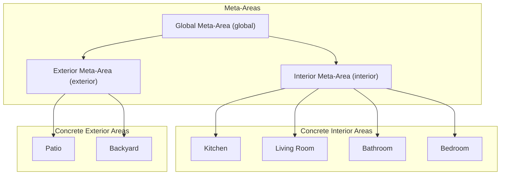
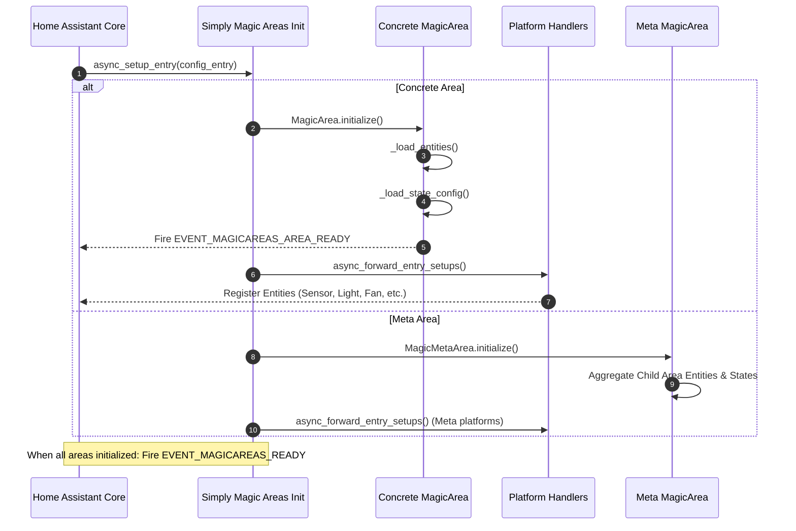
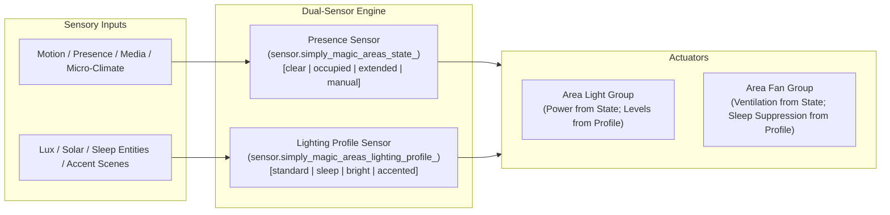
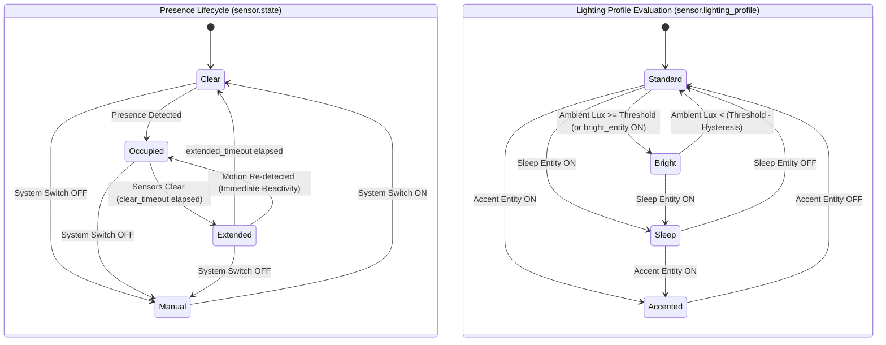
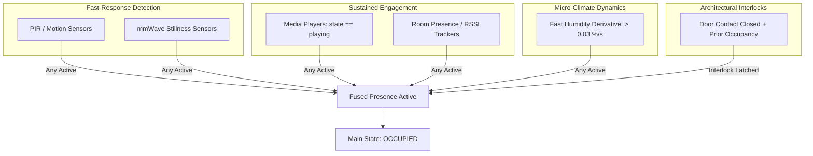
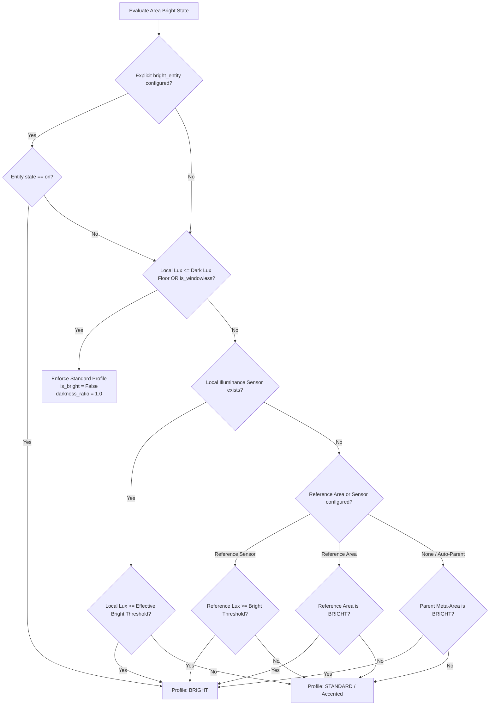

# Simply Magic Areas — Technical System Specification

## 1. Executive Summary

**Simply Magic Areas** is a Home Assistant custom integration that transforms static physical areas into dynamic, reactive, stateful environments. By grouping devices, synthesizing occupancy presence from disparate sensors, tracking ambient environmental trends, and coordinating automations across platforms (lighting, climate, ventilation, covers, media players, and distress monitoring), it turns areas into autonomous smart rooms.

All development and implementation within Simply Magic Areas is strictly governed by the engineering principles and architectural invariants codified in the [Project Constitution](constitution.md).

### 1.1 Foundational Design Philosophy: Zero-Configuration "It Just Works"

A guiding invariant of Simply Magic Areas is **Convention Over Configuration**: the system is architected to minimize configuration burden and work automatically, intuitively, and safely straight out of the box.

- **Zero-Touch Ingestion from Home Assistant Registries**: By simply assigning devices to an Area in Home Assistant's native Area Registry, Simply Magic Areas automatically discovers, aggregates, and coordinates all lights, exhaust fans, media players, climate units, and presence sensors. No manual entity mapping or YAML editing is required.
- **Intelligent Autonomous Heuristics & Dynamic Fallbacks**:
  - *Automatic Daylight / Illuminance Detection*: Rooms automatically derive their daytime/bright state using local illuminance sensors; if none exist, they dynamically borrow illuminance from an adjacent referenced room, the parent meta-area average, or solar sun elevation (`sun.sun`) without requiring manual daylight helper configuration.
  - *Automatic Differential Humidity Baselines*: En-suite and bathroom ventilation automatically pairs local humidity against interior baseline averages or climate sensors if an explicit reference entity is omitted.
  - *Automated Presence Sensor Fusion*: Native motion, occupancy, and presence sensors assigned to an area are fused into a unified presence tracker with zero manual mapping.
- **Sensible Human-Centric Defaults & Radical Simplicity**:
  - **Adaptive by Default**: Complex calibration is eliminated from the user journey. Both **Adaptive Lighting** (`learn_daylight_lux`) and **Adaptive Ventilation** (`learn_shower_humidity`) are **always enabled by default** (`default: True`). The system autonomously learns room-specific lux baselines and shower humidity signatures from sensor history without any setup.
  - **Simple Setup with Advanced Overrides Only**: The basic area configuration form contains only essential high-level intent (e.g. Area Type, Timeouts, Light Control, Fan Control). Detailed numerical calibrations, threshold overrides, and options to disable adaptive learning (`learn_daylight_lux`, `learn_shower_humidity`, `dark_lux_floor`, `daylight_lux_level`, and humidity rate cutoffs) are strictly encapsulated within dedicated **Advanced Settings** (`advanced_light_groups` and `humidity` feature configs). Everyday users never have to configure numerical thresholds.

---

## 2. System Architecture & Topology

### 2.1 Area Hierarchy & Meta-Areas

Simply Magic Areas categorizes spaces into two primary constructs:

1. **Concrete Areas**: Directly mapped to Home Assistant Area Registry entries.
   - **Interior (`interior`)**: Standard indoor rooms (living room, bedrooms, bathrooms).
   - **Exterior (`exterior`)**: Outdoor spaces (patio, backyard, driveway).
2. **Meta-Areas**: Synthetic aggregations created at higher spatial levels.
   - **Global (`Global`)**: Aggregates all interior and exterior areas across the entire home. Hosts global capabilities such as the Area-Aware Media Player (AAMP) and root configuration inheritance defaults.
   - **Interior Meta-Area (`Interior`)**: Aggregates all interior spaces and provides zone-level configuration defaults.
   - **Exterior Meta-Area (`Exterior`)**: Aggregates all exterior spaces and provides outdoor configuration defaults.
   - **Active Area Resolution (`get_active_areas()`)**: Meta-areas dynamically evaluate the states of all subordinate child areas and expose active non-clear child slugs in `get_active_areas()` and the state sensor's `active_areas` attribute (`ATTR_ACTIVE_AREAS`).
   - **Hierarchical Configuration Inheritance (`InheritedConfig`)**: Meta-areas serve as the central source of truth for shared spatial policies (notably `sleep_entity`, `sleep_state_dim`, `accented_entity`, `accented_state_dim`, `clear_timeout`, `extended_timeout`, `dark_lux_floor`, `fan_suppress_in_sleep`). Subordinate rooms automatically inherit these settings when left empty (`""` or unset). A room can define a local override (e.g. Master Bedroom sleep switch) or explicitly opt out (`"none"` / `"disabled"`). Modifying a meta-area's options dynamically reloads child rooms to immediately propagate policy changes without requiring a Home Assistant restart. See [designs/meta_area_config_inheritance_design.md](designs/meta_area_config_inheritance_design.md).

### 2.2 Lifecycle & Initialization Workflow

- **Dynamic Device Registry Tracking (`EVENT_DEVICE_REGISTRY_UPDATED`)**: Simply Magic Areas listens for device area reassignments in Home Assistant's Device Registry. When a physical device is moved between areas, affected area config entries reload automatically without requiring a Home Assistant restart.

---

## 3. Dual-Sensor Orthogonal State Architecture

To eliminate ambiguity between physical occupancy and contextual lighting scenes, Simply Magic Areas decouples environmental awareness into two distinct, orthogonal sensors for each area:

1. **Primary Area Presence Sensor (`sensor.simply_magic_areas_state_<area_slug>`)**:
   - **Device Class**: `SensorDeviceClass.ENUM`
   - **States**: `clear`, `occupied`, `extended`, `manual`
   - **Responsibility**: Pure presence and automation lifecycle. Answers the fundamental question: *"Is a human present in this area?"*
   - **Attributes**: In addition to presence attributes, exposes `lighting_profile` as an attribute for seamless backward compatibility.

2. **Secondary Lighting Profile Sensor (`sensor.simply_magic_areas_lighting_profile_<area_slug>`)**:
   - **Device Class**: `SensorDeviceClass.ENUM`
   - **States**: `standard`, `sleep`, `bright`, `accented`
   - **Responsibility**: Environmental and contextual scene profile. Answers the question: *"When illuminated, how should this room look?"*
   - **Continuous Operation**: Evaluates continuously regardless of occupancy. A bedroom maintains the `sleep` profile all night long, whether empty (`clear`), active (`occupied`), or transitioning (`extended`).

### 3.1 Primary Presence States (`sensor.simply_magic_areas_state_<area>`)

The presence state defines whether the room is occupied, clearing, or manually bypassed:

| State | Identifier | Description |
| :--- | :--- | :--- |
| **Clear** | `clear` | Idle base state. No presence detected by presence sensors and all timeout buffers have expired. Automated lights turn off or dim to clear level. |
| **Occupied** | `occupied` | Primary presence state. **Based entirely on active detection from presence sensors** (motion sensors, occupancy sensors, media playback, or room presence sensors). |
| **Extended** | `extended` | Transitionary timeout grace period after presence sensors cease detecting presence before reverting to `clear`. Keeps area ready or dimly lit for quick re-entry. |
| **Manual** | `manual` | Override state entered when the area system control switch is turned OFF (`switch.simply_magic_areas_system_control_<area>`). Suspends all automated state transitions and device controls across the area. *(Note: Individual light and fan manual overrides hold their manual state until an occupied state change occurs; see Section 4.1 and 4.2).* |

- **Self-Healing State Consistency Guard**: During startup or reload, `AreaStateSensor._validate_state_consistency()` confirms that if all presence sensors are off and no clear/extended timeout is active, any stale or orphaned occupied state is automatically corrected back to `clear`.

### 3.2 Secondary Lighting Profiles (`sensor.simply_magic_areas_lighting_profile_<area>`)

Lighting profiles dictate which fixtures activate and what dimming levels or color temperatures to apply when the area is illuminated:

| Profile | Identifier | Context & Lighting Behavior |
| :--- | :--- | :--- |
| **Standard** | `standard` | Default active profile when no secondary context overrides apply. Activates standard task and ambient lighting at configured daytime/occupied brightness. |
| **Sleep** | `sleep` | Bedtime/nighttime mode is active (e.g., bed presence or night mode helper). Configures low-level pathway lighting or night-lights at minimal brightness. |
| **Bright** | `bright` | High ambient lux / daylight threshold is active. Keeps lights off or dialed down to avoid redundant daytime illumination. |
| **Accented** | `accented` | Accent entity is active (e.g. party mode, dinner scene, decorative lighting). Prioritizes accent and architectural lighting fixtures. |

### 3.3 Orthogonal Interaction Matrix

The presence state and lighting profile operate concurrently. The matrix below defines actuator responses to their combinatorial states:

| Presence State | Lighting Profile | Resulting Light Group State | Action & Actuator Behavior |
| :--- | :--- | :--- | :--- |
| **`clear`** | Any (`standard`, `sleep`, `bright`, `accented`) | OFF (or Clear Dim Level) | Lights remain off. Profile changes in empty rooms do NOT turn lights on. |
| **`extended`** | Any | OFF (or Extended Dim Level) | Extended countdown proceeds. Exhaust fans ventilate (unless sleep suppressed). |
| **`manual`** | Any | Unchanged | Automation completely suspended. Human switch controls respected. |
| **`occupied`** | `standard` | ON | Standard task/ambient fixtures illuminated at default daytime dim level. |
| **`occupied`** | `sleep` | ON | Low-level pathway/night-light fixtures illuminated at sleep dim level (e.g. 10–30%). |
| **`occupied`** | `bright` | OFF (or Daylight Dim Level) | Ambient daylight suffices; lights kept off or dialed to zero to save energy. |
| **`occupied`** | `accented` | ON | Architectural accent fixtures illuminated at configured accent dim level. |
| **`occupied`** | Dynamic change (e.g. `standard` ➔ `sleep` at bedtime) | ON (Immediately Updated) | If lights are ON, transitioning profile **immediately cross-fades** to new fixtures and brightness. |

### 3.4 State & Profile Lifecycle Diagrams

### 3.5 Safe & Reliable Occupancy Derivation ("Fail-Safe" Occupancy Engineering)

> [!IMPORTANT]
> **The Asymmetry of Safety Principle (Zero Sudden Darkness):**
> In residential automation, false negatives (erroneously deciding a room is empty and plunging an occupant into darkness) are disruptive, frustrating, and unsafe—particularly in showers, on staircases, or in kitchens. Conversely, a brief false positive (leaving lights on for an extra minute or two after departure) carries trivial energy cost.
>
> Therefore, Simply Magic Areas enforces **Fail-Safe Asymmetric Confidence**: the system activates presence instantly upon any affirmative signal and requires strict, multi-stage confirmation before vacating.

#### 3.5.1 Multi-Modal Sensor Fusion
To derive occupancy in the safest and most reliable manner, Simply Magic Areas evaluates presence across multiple distinct sensory modalities:

1. **Fast-Response Indicators (PIR Motion)**: Detects initial entry with millisecond responsiveness, instantly waking the room.
2. **Sustained Stillness Detection (mmWave Presence)**: Detects micro-movements (breathing, typing, reading) to maintain occupancy when occupants remain stationary.
3. **Active Engagement Latch (Media Players)**: When media players in the area are actively `playing` (e.g. TV, music streamer), the room is automatically maintained in `occupied` to prevent lights or displays extinguishing during passive viewing or listening.
4. **Micro-Climate Derivative Indicators (Humidity Rate-of-Rise)**: A rapid spike in humidity (`change_second > 0.03 %/s`) indicates an active shower, bath, or cooking session, immediately engaging or preserving presence even before optical sensors register through fogged glass or closed shower curtains.
5. **Architectural Interlocks (Door Contact Occupancy Latching)**: When an area is occupied and a perimeter/entry door closes (such as a bathroom or private office), presence is latched to eliminate sensor blind spots until the door is reopened.
6. **Room Proximity & BLE (MQTT Room Presence)**: Proximity RSSI sensors track individual device locations to reinforce presence.

#### 3.5.2 Instantaneous Preemption & State Assertion (`force=True`)
- The moment any presence sensor fires, `AreaStateSensor` transitions immediately to `occupied`.
- All pending clear or extended timeouts are synchronously canceled.
- Commands to turn on lights and systems enforce execution (`force=True`), immediately aborting any in-flight turn-off service calls or racing states to ensure zero latency between entry and illumination.

#### 3.5.3 Tiered Graceful Degradation & Early Warning
Rooms never abruptly drop from `occupied` to `clear`. Departure follows a multi-tiered safety protocol:
1. **Clear Timeout Buffer (`clear_timeout`, default: 60s)**: When physical sensors stop detecting motion, a buffer timer begins, filtering out temporary stillness or sensor blind spots.
2. **Extended Grace & Warning Period (`extended_timeout`, default: 120s)**: The room transitions to `extended`. In advanced lighting setups, lights dim to the extended level (e.g. 50%), providing a clear visual cue to occupants that departure is pending while keeping the room safely illuminated.
3. **Instantaneous Reactivity During Extended**: If *any* sensor detects presence during the extended state, the system instantly snaps back to `occupied`, cancels the extended timer, resets the clear buffer, and restores full task lighting without delay.

#### 3.5.4 Self-Healing State Consistency & Fault Recovery
- **Startup & Restart Validation (`_validate_state_consistency()`)**: When Home Assistant restarts or the integration reloads, the state machine cross-references current sensor states. If all presence sensors are off and no timers were persisted, stale or orphaned `occupied` states are safely cleared to prevent rooms becoming stuck indefinitely.
- **Anti-Fighting Wall Switch Resilience**: If an external command or physical switch turns off lights while human presence remains affirmatively verified (and no manual override was set), the system automatically re-asserts lighting to protect occupants from accidental deactivation.
- **Context Isolation**: Substates (`sleep`, `bright`, `accented`) modulate *how* the room is illuminated, but never influence *whether* human presence exists. Presence detection is completely decoupled from contextual scene profiles.

### 3.6 Adaptive Lux, In-Situ Daylight Learning & Dark Floor Architecture

To evaluate the `bright` daytime profile and modulate illumination levels without requiring tedious manual calibration across inconsistent hardware sensors, Simply Magic Areas combines historical daylight learning, a guaranteed dark lux floor, and a three-tier brightness resolution hierarchy:

#### 3.6.1 The Dark Lux Floor (`CONF_DARK_LUX_FLOOR`, Default: `10` lx) & Windowless Spaces
- **Asymmetric Safety Invariant**: A room whose illuminance is at or below the dark lux floor ($L \le L_{floor}$) or identified as windowless (`is_windowless = True`) is **strictly prohibited from entering the `bright` profile**, regardless of solar elevation, daytime binary helpers, or bright states in parent meta-areas.
- **Windowless Space Detection**: Rooms that consistently read at or below $L_{floor}$ during solar midday when artificial lights are off are automatically categorized as windowless (`ATTR_IS_WINDOWLESS: true`). Entering occupants are guaranteed 100% illumination without false suppression from exterior daytime conditions.

#### 3.6.2 Autonomous Historical Daylight Baseline Learning (`CONF_LEARN_DAYLIGHT_LUX`)
- Detailed photometric, empirical, and mathematical models are codified in the [Adaptive Lux & Historical Daylight Learning Design Document](designs/adaptive_lux_lighting_design.md).
- **Hardware Sensor Variance Mitigation**: Real-world residential lux sensors exhibit massive variances (300%–500% hardware skew, differing window orientations, tinted glass). Hardcoded static thresholds cause north-facing rooms to never register daylight and south-facing rooms to extinguish lights prematurely.
- **Uncontaminated Ambient Sampling**: During daytime hours (`sun.sun == above_horizon`), whenever artificial lights in the area are completely **OFF**, `AreaLightingProfileSensor` samples natural ambient daylight without fixture back-scatter.
- **Asymmetric Peak & Seasonal Filter**:
  $$\Delta L = L_{sample} - L_{day}$$
  $$L_{day}^{(t+1)} = \begin{cases} L_{day}^{(t)} + \alpha_{up} \cdot \Delta L & \text{if } \Delta L > 0 \quad (\alpha_{up} = 0.25) \\ L_{day}^{(t)} + \alpha_{down} \cdot \Delta L & \text{if } \Delta L < 0 \quad (\alpha_{down} = 0.05) \end{cases}$$
  Tracks bright clear sky peaks rapidly while drifting down smoothly with seasonal cloud cover and winter solar angles.
- **Zero-Configuration Operation**: If `bright_lux_threshold` is left at default `0`, the integration automatically adopts the learned `historical_daylight_lux` as its bright cutoff threshold.

#### 3.6.3 Three-Tier Brightness Resolution Hierarchy
1. **Tier 1 — Local Illuminance Sensor (`sensor.simply_magic_areas_illuminance_<area>`)**:
   - Rooms with their own illuminance sensor evaluate directly against configured or learned bright threshold.
   - A configurable hysteresis band (`CONF_BRIGHT_LUX_HYSTERESIS`, default: `25` lx) prevents flickering during twilight or passing cloud cover (turn on at `threshold`, turn off at `threshold - hysteresis`).
2. **Tier 2 — Referenced Illuminance or Sibling Area**:
   - For rooms without an illuminance sensor (hallways, closets, interior bathrooms):
     - **Reference Area (`CONF_REFERENCE_BRIGHT_AREA`)**: Mirrors the `bright` state of an adjacent room with windows (e.g. `living_room`).
     - **Reference Illuminance Sensor (`CONF_REFERENCE_ILLUMINANCE_SENSOR`)**: Borrows a lux reading from another room or outdoor weather station.
     - **Automatic Meta-Area Fallback**: If no specific reference is configured, interior rooms inherit brightness from parent `interior` or `global` meta-area (unless protected by windowless dark floor).
3. **Tier 3 — Explicit Binary Entity (`bright_entity`) Fallback**:
   - Configured binary entities (`sun.sun`, `input_boolean.daytime`, or threshold helpers) are evaluated for full backward compatibility.

---

## 4. Platform Controllers & Capabilities

### 4.1 Lighting (`light.py`)
- **Entity**: `AreaLightGroup` (`light.simply_magic_areas_light_<area>`).
- **State-Driven Lighting Profiles**:
  - Each Main State (`clear`, `extended`) and Occupied Substate (`occupied`, `sleep`, `bright`, `accented`) has dedicated configuration:
    - Target dim level percentage (0–100%).
    - Explicit list of active lighting entities assigned to that substate.
- **Substate Transition Rules**:
  - **State Invariance**: When the contextual substate changes (such as from `bright` to `sleep`), the state of the lights stays as `occupied`, `clear`, `extended`, or `manual` and does not change.
  - **Lights ON (`occupied`)**: If the lights are on (`occupied`) and the contextual substate changes between `sleep`, `bright`, and `accented`, the lights **immediately update to the new values** (brightness level, color temperature, and active entity subset).
  - **Lights OFF (`clear`, `manual`, or `bright` at 0%)**: If the lights are off, substate changes (e.g. `bright` to `sleep` at night) do **not** trigger any light command. The lights remain off and the state remains `clear` or `manual` without change.
  - **New Presence Detected**: When the area transitions from `clear` or `extended` into `occupied`, the lights turn ON using the active substate's configured settings.
- **Proportional Darkness Compensation (Adaptive Turn-On Brightness)**:
  - When lights turn on, the controller inspects local illuminance $L$, learned daylight baseline $L_{day}$, and the dark lux floor $L_{floor}$.
  - Computes the darkness ratio:
    $$\text{darkness\_ratio} = \min\left(1.0, \max\left(0.0, \frac{L_{day} - L}{L_{day} - L_{floor}}\right)\right)$$
  - Applies perceptual Stevens' power-law curve ($\gamma = 0.65$) matching human visual perception:
    $$\text{target\_brightness} = \text{round}\left(\text{base\_brightness} \times (\text{darkness\_ratio})^{0.65}\right)$$
  - **Threshold Boundary Guarantees**:
    - If $L \le L_{floor}$ or `is_windowless`: $\text{darkness\_ratio} = 1.0 \implies 100\%$ target profile brightness.
    - If $L \ge L_{day}$: $\text{darkness\_ratio} = 0.0 \implies$ lights remain off or turn off (`force=True`).
    - Between $L_{floor}$ and $L_{day}$: Delivers smooth, natural twilight compensation without over-illuminating partially lit rooms.
  - Exposes `darkness_ratio` as a live state attribute on `AreaLightGroup`.
- **Manual Light State & Override (Occupancy-Hold)**:
  - **Transition to Manual State**: If someone manually adjusts a light (turns a light on or off, adjusts brightness, or changes color via a physical wall switch, smart dimmer, external integration, or Home Assistant UI), the light entity automatically transitions into a **Manual State** (exposing `manual_control: true` in its extra state attributes).
  - **Override Automatic State**: While in this manual state, the automatic lighting control is completely overridden and suspended. Contextual lighting profile shifts (e.g. `standard` to `sleep` or `bright`) or ambient illuminance fluctuations will **not** modify, extinguish, or alter the light fixtures. This guarantees that automated routines never fight human manual preferences.
  - **Occupancy-Hold Duration**: The manual state persists and is held steadily until an **occupied state change** occurs:
    - **Clear $\to$ Occupied**: When presence is detected in a previously clear area, manual override resets and normal profile-based automated lighting engages.
    - **Occupied / Extended $\to$ Clear**: When an occupied or extended room completely clears, manual override resets and lights extinguish in accordance with clear state automation.
    - **Occupied $\leftrightarrow$ Extended**: Transitions between occupied and extended buffers (or vice-versa) do not reset manual override, preserving human intent while the room remains occupied.
    - **Master Switch Reset**: Toggling the Area System Control Switch (`switch.simply_magic_areas_system_control_<area>`) back ON immediately clears any manual holds.
- **Rapid Transition & Race Condition Resilience**:
  - **Forced Turn-On on Occupancy**: When transitioning into an occupied state from non-occupied (`clear` or `extended`), `_turn_on_light` enforces execution (`force=True`). It bypasses cached state checks (`is_on` / matching brightness) so that a pending in-flight turn-off never prevents the lights from being commanded on.
  - **Turn-Off Occupancy Guard**: `_turn_off_light` verifies that the area is not currently in an occupied state before issuing any off command. If the area has transitioned back to occupied, the turn-off is aborted immediately.
  - **Respect for Manual Turn-Off**: External manual turn-off actions are recognized immediately without re-assertion or extinguishment fighting.
  - **Presence Timer Preemption**: When a presence sensor reports `on`, all running clear and extended timers in `AreaStateSensor` are cancelled synchronously, preventing background timer callbacks from clearing the area.
  - **Unoccupied State Preservation**: In `AreaStateSensor`, when the area is `clear` or `extended`, non-occupied sensor state updates do not reset off-time counters or cause premature occupancy fall-throughs.
  - **Extended State Sensor Reactivity**: If the area is in the `extended` state, any state change in the sensors (presence sensors or room tracking sensors) immediately moves the area state back to `occupied`, cancels running extended timeouts, restarts the clear countdown buffer, and re-engages lighting automations (turning off exhaust ventilation unless prolonged by high humidity).
- **Asynchronous Non-Blocking Execution**: In accordance with the Project Constitution, light command dispatches (`turn_on`, `turn_off`) utilize non-blocking async task dispatching (`call_service_non_blocking`), preventing event loop latency or blocking deadlocks across both loop callbacks and worker threads.

#### 4.1.1 Exterior Nighttime Lighting & Presence Control
For exterior spaces of the home (both concrete areas classified as `type: exterior` such as Porches, Patios, Driveways, and Yards, as well as the composite `Exterior` Meta-Area), Simply Magic Areas implements an autonomous outdoor lighting automation cycle:
- **Sunset Dusk Trigger**: When `sun.sun` transitions to `below_horizon` (or solar elevation $\le 0^\circ$), exterior lights automatically turn ON and initialize a 2-hour inactivity countdown clock ($T = 7200\text{s}$).
- **2-Hour Minimum Stay-On Guarantee**: Once activated, lights remain ON for at least two hours ($7200\text{s}$).
- **Motion & Camera Reactivity**: Movement detected by exterior motion/presence sensors, vision cameras (`camera.*`), or child exterior areas restarts the 2-hour clock. When physical movement ceases ($E_{\text{motion}} \to 0$), the 2-hour timer resets from that exact clearance moment ($t_{\text{off}} + 7200\text{s}$).
- **Resident Arrival Illumination**: Whenever any resident arrives home (any `person.*` entity in Home Assistant transitioning to `STATE_HOME` during nighttime), exterior lights turn ON (or restart their clock) to illuminate entry paths.
- **Daytime Suppression**: During solar daytime (`sun.sun` is `above_horizon` or elevation $> 0^\circ$), exterior lights remain OFF and are suppressed from turning on upon motion or resident arrival.
- **Sunrise Unconditional Clearance**: At sunrise (`sun.sun` transitions to `above_horizon`), any running exterior timer is cancelled and exterior lights are unconditionally extinguished (`force=True`).
- **Decoupled Clearance Invariant**: Physical area clearance (`AreaState.AREA_STATE_CLEAR`) does not extinguish exterior lights while `exterior_lighting_active` is true. The 2-hour stay-on clock runs uninterrupted without falsely presenting uninhabited yards as occupied on Home Assistant dashboards.
- **Restart & State Rehydration**: Recovers `exterior_timer_ts` across Home Assistant restarts; if nighttime and time remains, re-arms `async_call_later` for the remaining duration.
- **Exposed Extra State Attributes**:
  - `exterior_lighting_active`: Boolean indicating active outdoor stay-on control.
  - `exterior_timer_ts`: Unix timestamp when the 2-hour stay-on clock expires.
  - `exterior_trigger_reason`: Latest trigger event (`"sunset"`, `"motion"`, `"arrival"`).
- **Zero-Config Defaults & Advanced Settings**: Enabled by default out of the box (`CONF_EXTERIOR_LIGHTING_TIMEOUT`: 7200s, `CONF_EXTERIOR_SUNSET_TRIGGER`: True, `CONF_EXTERIOR_ARRIVAL_TRIGGER`: True) and customizable only under Advanced Settings.

### 4.2 Ventilation & Fans (`fan.py`)
- **Entity**: `AreaFanGroup` (`fan.simply_magic_areas_fan_<area>`).
- **Post-Occupancy Ventilation (`extended` state)**:
  - **Bathroom & Room Exhaust**: When occupants leave the room and the area transitions from `occupied` to `extended` (e.g. leaving a bathroom), the lighting turns off (or dims to clear level) and the exhaust fan **automatically turns ON**.
  - **Extended Duration**: The fan remains on for the duration of the configured `extended_timeout` period before turning off when transitioning to `clear`, unless prolonged by elevated humidity.
- **Acoustic Fan Suppression in Sleep Mode (`CONF_FAN_SUPPRESS_IN_SLEEP`)**:
  - **En-Suite & Bedroom Quiet Hours**: When enabled (`fan_suppress_in_sleep: true`), exhaust fans are prevented from turning on during `extended` mode if sleep mode is active.
  - **Sleep Source Detection**: Evaluates whether the current area is in `sleep` substate, whether the area's configured `sleep_entity` is active, or whether a referenced adjacent area (e.g. Master Bedroom for an Ensuite via `CONF_REFERENCE_BRIGHT_AREA`) is in `sleep` state.
  - **Dynamic State Reactivity**: If sleep activates while the fan is actively running in `extended` mode, the fan is immediately turned OFF. Conversely, if sleep mode ends while the room remains in `extended` mode, the fan automatically turns ON for the remaining extended timeout.
  - **Humidity Extraction Precedence**: Steam and moisture extraction take safety precedence over acoustic suppression. If differential humidity triggers ventilation (`humidity_on: true`), the fan activates regardless of sleep state to protect against mold and condensation buildup.
- **Enhanced Humidity & Climate Differential Ventilation**:
  - Detailed physical and empirical calculations, rate-of-change models, and shower dynamics are codified in the [Bathroom Humidity Dynamics & Adaptive Shower Fan Control Design Document](designs/bathroom_humidity_fan_design.md).
  - **Autonomous Multi-Tier Reference Resolution (Zero-Config)**:
    - To eliminate mandatory configuration while guaranteeing differential accuracy, Simply Magic Areas resolves baseline indoor humidity automatically:
      1. Configured `reference_humidity_sensor` (if explicitly provided).
      2. Parent `Interior` Meta-Area humidity sensor (automatic average of indoor rooms).
      3. Any neighboring interior area humidity sensor (e.g. hallway, living room).
      4. Area climate entity `current_humidity` attribute.
  - **Dual-Trigger Shower Activation**:
    - **Trigger A (Dynamic Rapid Rise)**: Rate-of-change from `MagicStatisticsSensor` (`change_second`) exceeds `CONF_HUMIDITY_TREND_UP_CUT_OFF` (default: `0.03 %/s` ≈ 1.8%/min) with humidity above baseline, turning the fan on within the first 30–60 seconds of a shower to prevent mirror fogging and wall condensation.
    - **Trigger B (Sustained Differential Delta)**: If room humidity exceeds baseline by `CONF_HUMIDITY_DELTA_THRESHOLD` (default: `10.0%`), the fan activates regardless of whether the derivative is spiking (protecting against soaking baths, gradual warm moisture build-up, or delayed wireless sensor intervals).
  - **Drying Slope Sustain Invariant (Negative Trend Protection)**:
    - While moisture extraction is active (`humidity_on: true`), a falling derivative ($dRH/dt < 0$) indicates successful moisture exhaustion and **does NOT shut off the fan** while `humidity_delta > delta_shutoff`.
    - The fan runs continuously throughout the negative drying slope until the moisture is actually cleared.
  - **Shut-off Criteria & Safety Boundaries**:
    - **Baseline Normalization**: The fan shuts off once room humidity returns to `humidity_delta <= delta_shutoff` (default: `3.0%` above reference), verifying that dry ambient conditions have been restored.
    - **Deadband Flatline Deactivation**: Replaces brittle `0.0` checks with a configurable deadband `CONF_HUMIDITY_DEADBAND` (default: `0.001 %/s` ≈ 3.6 %/hr). When the derivative hovers within `[-0.001, +0.001] %/s` continuously for `CONF_HUMIDITY_ZERO_WAIT_TIME` (default: `900s` / 15 minutes), the plateau is confirmed stabilized and the fan turns off.
    - **Standalone Fallback**: If no baseline reference entity exists in the home, falling trend (`trend_val < trend_down_cutoff`) or deadband flatline terminates extraction.
    - **Safety Maximum Runtime (`CONF_HUMIDITY_MAX_FAN_TIME`, default: `3600s` / 60 minutes)**: Hard safety cutoff capping continuous humidity-driven fan runtime to protect fan motors and prevent excessive conditioned air exhaustion.
  - **Presence Gating (`CONF_HUMIDITY_PRESENCE_GATE_TIME`, default: `0s` / disabled)**:
    - Optional gating window ensuring humidity spikes only activate fans if the area is currently occupied or was occupied within the gate window, filtering out weather infiltration in vacant homes.
  - **State Precedence & Area State Synchronization**:
    - While the room is actively in `extended` state, the fan will not be turned off prematurely by humidity normalization. Similarly, humidity-driven ventilation stays active across `extended` -> `clear` transitions until all shutoff criteria or timeouts are met.
    - `AreaStateSensor` synchronizes its occupancy derivation and attributes (`humidity_on`, `humidity_delta`, `humidity_zero_ts`) with the differential threshold, deadband, and presence gating so climate humidity drift does not falsely force areas into `occupied`.
  - **Autonomous Historical Humidity & Adaptive Shower Signature Learning (`CONF_LEARN_SHOWER_HUMIDITY`)**:
    - Detailed physical, thermodynamic, and mathematical models are codified in the [Adaptive Humidity & Historical Shower Signature Learning Design Document](designs/adaptive_humidity_shower_design.md).
    - **Problem Solved**: Sensor placement variations (ceiling vs. vanity vs. wall outlet) and bathroom volumes cause empirical peak rates of rise ($(dRH/dt)_{peak}$) to vary by over an order of magnitude ($0.03\text{--}0.35\ \%/\text{s}$) and peak humidity deltas ($\Delta H_{peak}$) to range from $8\%$ to $45\%$. Static hardcoded thresholds cause false triggers in small half-baths or failure to detect showers in large master ensuites.
    - **Autonomous Ambient Baseline Tracking ($H_{base}$)**:
      - Whenever the room is idle ($|dRH/dt| < \text{trend\_up\_cutoff}$ and $RH_{room} \le H_{base} + 5.0\%$), the controller samples the ambient background humidity and updates $H_{base}$ via Exponential Moving Average:
        $$H_{base}^{(t+1)} = (1 - \alpha_{base}) \cdot H_{base}^{(t)} + \alpha_{base} \cdot RH_{sample} \quad (\alpha_{base} = 0.05)$$
      - Eliminates requirement for an external reference humidity sensor. If no external sensor is configured, $\Delta H = RH_{room} - H_{base}$.
    - **Empirical Shower Signature Learning**:
      - During active shower extraction sessions, the controller continuously tracks the peak derivative reached ($(dRH/dt)_{peak, event}$) and peak delta reached ($\Delta H_{peak, event}$).
      - Upon session conclusion, historical peak metrics are adapted via EMA ($\alpha_{shower} = 0.30$):
        $$\Delta H_{peak} \leftarrow (1 - \alpha_{shower}) \cdot \Delta H_{peak} + \alpha_{shower} \cdot \Delta H_{peak, event}$$
        $$(dRH/dt)_{peak} \leftarrow (1 - \alpha_{shower}) \cdot (dRH/dt)_{peak} + \alpha_{shower} \cdot (dRH/dt)_{peak, event}$$
    - **Dynamic Threshold Adaptation**:
      - If historical learning is enabled (`learn_shower_humidity: true`), thresholds automatically scale to match the room's empirical signature:
        $$\Delta H_{trigger} = \max\left(5.0\%, 0.50 \cdot \Delta H_{peak}\right)$$
        $$Trend_{trigger} = \max\left(0.015\ \%/\text{s}, 0.50 \cdot (dRH/dt)_{peak}\right)$$
        $$\Delta H_{shutoff} = \max\left(2.0\%, 0.25 \cdot \Delta H_{trigger}\right)$$
    - **Failsafe Boundaries & Noise Floor Guard**:
      - **Noise Floor Rejection**: Trigger A (rapid derivative rise) requires $\Delta H > \Delta H_{shutoff}$ before activating, rejecting sensor jitter or minor ambient perturbations when the absolute delta is tiny.
      - **Absolute Ceiling Guard**: If $RH_{room} \ge 80\%$, the fan unconditionally activates regardless of trend rate or baseline differential, guaranteeing anti-mold protection during extreme condensation.
  - **Exposed Fan State Attributes**:
    - `humidity_on`: Boolean indicating whether humidity ventilation is active.
    - `humidity_delta`: Floating-point difference between room humidity and baseline.
    - `reference_humidity`: Current value of the reference or learned baseline sensor.
    - `historical_humidity_baseline`: Idle ambient baseline humidity ($H_{base}$).
    - `historical_shower_count`: Cumulative number of showers observed and adapted.
    - `historical_shower_delta_peak`: Learned typical peak humidity rise ($\Delta H_{peak}$).
    - `historical_shower_rate_peak`: Learned typical peak rate of rise ($(dRH/dt)_{peak}$).
    - `learned_humidity_delta_threshold`: Dynamically scaled activation delta threshold.
    - `learned_humidity_trend_up_cutoff`: Dynamically scaled activation derivative threshold.
    - `learned_humidity_delta_shutoff`: Dynamically scaled normalization recovery shutoff delta.
    - `humidity_start_ts`: Epoch timestamp when current humidity ventilation session began.
    - `humidity_zero_ts`: Epoch timestamp when humidity derivative entered the stationary deadband.
    - `max_runtime_exceeded`: Safety flag set when the fan is stopped due to exceeding `humidity_max_fan_time`.
- **Manual Fan Override (Occupancy-Hold)**:
  - Manual adjustments (wall switches, UI) transition the fan group into manual override mode (`manual_control: true`), holding the commanded state until an **occupied state change** occurs (e.g. `occupied/extended -> clear` or `clear -> occupied`).
  - While in manual override, autonomous humidity ventilation and sleep suppression adjustments are suspended to respect user preferences.

### 4.3 Climate (`climate.py`)
- **Entity**: `AreaClimateGroup` (`climate.simply_magic_areas_climate_<area>`).
- **Consolidated Thermostat Control**:
  - Unifies multiple HVAC devices in an area.
  - Averages ambient temperature readings (`mean` reduction).
  - Synchronizes target temperatures, HVAC modes (`heat`, `cool`, `auto`, `off`), fan modes, swing modes, and presets across child units.
- **Occupancy Setbacks**:
  - Automatically adjusts climate to comfort setpoints upon occupancy.
  - Applies eco/setback temperatures during `clear` or `sleep` states.

### 4.4 Media Players & Global Notification (`media_player.py`)
- **Area Group**: `AreaMediaPlayerGroup` (`media_player.simply_magic_areas_media_player_<area>`).
  - Aggregates speakers/smart TVs per area; syncs playback state and volume.
- **Area-Aware Media Player (AAMP)**: `AreaAwareMediaPlayer` (Global Meta-Area).
  - **Dynamic Routing**: Dispatches `play_media` calls and TTS announcements dynamically to whichever room currently has active occupancy.
  - If no area is actively occupied, falls back to pre-configured fallback audio sinks or the entire house group.

### 4.5 Binary Sensors & Health Distress Monitor (`binary_sensor.py`)
- **Aggregate Device Classes**:
  - Groups binary sensors having `CONF_AGGREGATES_MIN_ENTITIES` (e.g. `door`, `window`, `motion`).
  - Aggregates using `any` (default) or `all` mode depending on `AGGREGATE_MODE_ALL`.
- **Distress / Area Health Sensor**:
  - Creates `binary_sensor.simply_magic_areas_problem_<area>`.
  - Monitors `smoke`, `gas`, `moisture`, `safety`, and `problem` classes.
  - Fires immediate alerts if any life-safety or environmental hazard sensor is tripped.

### 4.6 Environmental & Statistical Sensors (`sensor.py`)
- **Group Aggregators**:
  - Calculates `mean` (temperature, illuminance) or `sum` (energy, power) for numeric sensors in the area.
  - **Unitless Sensor Aggregation**: Safely aggregates unitless sensor device classes (e.g., `SensorDeviceClass.AQI`, `SensorDeviceClass.PH`) without entity rejection, properly handling `unit_of_measurement=None`.
  - **Long-Term Statistics for Energy & Utilities**: Automatically assigns `SensorStateClass.TOTAL_INCREASING` to cumulative `gas` and `water` meter aggregates (and `TOTAL` to `energy`), providing native long-term statistical integration with the Home Assistant Energy Dashboard.
- **Statistical Derivatives**:
  - Generates moving statistical analysis (percentiles, rolling averages) via Home Assistant's `StatisticsSensor`.
  - Powers humidity rate-of-rise trend tracking.

### 4.7 Automation Switch (`switch.py`)
- **Entity**: `AreaSystemControlSwitch` (`switch.simply_magic_areas_system_control_<area>`).
- **Function**:
  - Master kill switch for all automated behaviors within the given area.
  - When switched `off`, sets area state to `manual`. When switched `on`, immediately resumes automatic state evaluation.

### 4.8 Machine Learning & Multi-Sensor Signal Processing (`ml/`)

#### 4.8.1 Local Online Bayesian Lighting Preference Learner (`lighting_learner.py`)
- **100% Local / Zero-Cloud**: Operates completely on the local Home Assistant instance with pure Python matrix math ($\mathcal{O}(d^2)$ complexity $< 1\mu\text{s}$) with zero cloud dependencies or external pip packages.
- **Recursive Least Squares (RLS)**: Intercepts manual user brightness adjustments on `AreaLightGroup` to continuously learn the household's actual lux-to-brightness preference curve:
  $$\mathbf{x} = [1.0, \text{normalized\_lux}, \sin(\theta_{\text{solar}}), \text{profile\_factor}], \quad y = \text{commanded\_brightness}$$
- **Dynamic Blending**: Smoothly blends prior heuristics with learned weights based on sample count ($C = \min(1.0, N / 5.0)$), preserving daylight cutoffs while tailoring room brightness to occupant preference.
- **Local Persistence**: Saves state locally across restarts via Home Assistant's `Store` helper in `.storage/simply_magic_areas_lighting_ml_<area>`.
- **Diagnostic Attributes**: Exposes `ml_adaptive_lighting_active`, `ml_preference_samples`, `ml_confidence`, and `ml_predicted_brightness`.

#### 4.8.2 mmWave Radar Fan vs. Human False-Presence Discriminator (`mmwave_filter.py`)
- **Causal Actuator Coupling**: Directly correlates with the operational state of `AreaFanGroup` and physical fans in the area. When fans are OFF, radar presence operates with standard high sensitivity.
- **Distance Gate & Spatial Masking**: Detects radar targets reporting distance in the fan zone ($1.8\text{m} \le \text{dist} \le 3.5\text{m}$) and low-variance reflections characteristic of constant-RPM fan blades ($\sigma^2 < 0.02$).
- **Multi-Signal & Secondary Sensor Element Evaluation**: When it is clear the mmWave sensor is detecting a fan, the primary `occupancy` state is bypassed. If the sensor exposes secondary signals (macro-motion energy $\ge 20$, multi-target tracking outside the fan zone $[1.8\text{m}, 3.5\text{m}]$, unmasked range gates 0, 1, 5–8 energy $\ge 20$, or companion motion binary sensors), those other elements are evaluated to determine whether an occupant is actually present in the room:
  - If other elements confirm human presence, the room remains `occupied` and the sensor is added to `radar_fan_override_sensors`.
  - If other elements show no human presence, the sensor is silenced as fan interference and added to `filtered_fan_sensors`.
  - If the sensor does not expose secondary signals to work this out, it falls back to standard universal dwell filtering.
- **Universal Binary Radar Dwell Filter**: If only a binary presence radar is available without secondary signals or distance attributes, filters out persistent radar occupancy when all other area presence sensors have cleared for $\ge 30\text{s}$ while a fan is running.
- **Diagnostic Entity Attributes**: Exposes `filtered_fan_sensors` (`ATTR_FILTERED_FAN_SENSORS`) and `radar_fan_override_sensors` (`ATTR_RADAR_FAN_OVERRIDE_SENSORS`) on `AreaStateSensor` for full user transparency.

---

## 5. Entity ID & Unique ID Specifications

| Domain | Entity Translation Key | Entity ID Format | Unique ID Format |
| :--- | :--- | :--- | :--- |
| `sensor` | `state` | `sensor.simply_magic_areas_state_<area_slug>` | `simply_magic_areas_state_<area_slug>` |
| `sensor` | `lighting_profile` | `sensor.simply_magic_areas_lighting_profile_<area_slug>` | `simply_magic_areas_lighting_profile_<area_slug>` |
| `switch` | `system_control` | `switch.simply_magic_areas_system_control_<area_slug>` | `simply_magic_areas_system_control_<area_slug>` |
| `light` | `light` | `light.simply_magic_areas_light_<area_slug>` | `simply_magic_areas_light_<area_slug>` |
| `fan` | `fan` | `fan.simply_magic_areas_fan_<area_slug>` | `simply_magic_areas_fan_<area_slug>` |
| `climate` | `climate` | `climate.simply_magic_areas_climate_<area_slug>` | `simply_magic_areas_climate_<area_slug>` |
| `media_player`| `media_player` | `media_player.simply_magic_areas_media_player_<area_slug>` | `simply_magic_areas_media_player_<area_slug>` |
| `media_player`| `area_aware_media_player` | `media_player.simply_magic_areas_area_aware_media_player_<slug>`| `simply_magic_areas_area_aware_media_player_<slug>` |
| `cover` | `cover_<class>` | `cover.simply_magic_areas_cover_<class>_<area_slug>` | `simply_magic_areas_cover_<class>_<area_slug>` |
| `binary_sensor`| `<device_class>` | `binary_sensor.simply_magic_areas_<class>_<area_slug>` | `simply_magic_areas_<class>_<area_slug>` |
| `binary_sensor`| `problem` | `binary_sensor.simply_magic_areas_problem_<area_slug>` | `simply_magic_areas_problem_<area_slug>` |

---

## 6. Configuration & Feature Schema

### 6.1 Basic Area Configuration (`area_config` / `OPTIONS_AREA`)
> [!TIP]
> **Radical Simplicity:** The basic setup presents only essential intent. All adaptive daylight learning, shower humidity learning, and mmWave fan filtering algorithms run autonomously out of the box with zero user configuration required.

- `type`: Area classification (`interior`, `exterior`, `meta`).
- `clear_timeout`: Seconds of sensor inactivity before transitioning `occupied` -> `extended` (default: `60s`).
- `extended_timeout`: Seconds of sensor inactivity before transitioning `extended` -> `clear` (default: `120s`).
- `icon`: Icon for the area.
- `light_control`: Enable automatic lighting automation for this area (default: `True`).
- `fan_control`: Enable automatic exhaust fan automation for this area (default: `True`).
- `fan_suppress_in_sleep`: Suppress exhaust fan operation during `extended` state when sleep mode is active (default: `False`).
- `mqtt_room`: Enable MQTT room presence tracking (default: `False`).

### 6.2 Advanced Options & Feature Overrides

Advanced calibration and overrides are strictly encapsulated in dedicated advanced feature menus:

#### 6.2.1 Advanced Light Groups (`CONF_FEATURE_ADVANCED_LIGHT_GROUPS`)
- `learn_lighting_preferences`: Enable 100% local Bayesian online preference learning from manual brightness overrides (default: `True`).
- `mmwave_fan_filter`: Enable mmWave radar fan vs. human discrimination (default: `True`).
- `learn_daylight_lux`: Autonomously learn the daylight lux baseline from room sensor history (default: `True`). Toggle to `False` to turn off adaptive lighting.
- `dark_lux_floor`: Ambient lux at or below which room is dark and lights always turn on (default: `10` lx).
- `daylight_lux_level`: Manual daylight baseline override in lux (default: `0` = auto-learn from sensor history).
- `include_entities` / `exclude_entities`: Explicit entity inclusion or exclusion lists.
- `update_interval`: Heartbeat re-evaluation interval (default: `60s`).
- `on_states`, `presence_device_platforms`, `presence_sensor_device_class`: Custom presence sensor definitions.
- Light scenes: Custom dim levels and entity assignments for `occupied`, `sleep`, `bright`, `accented`, `clear`, and `extended` states.

#### 6.2.2 Advanced Ventilation & Humidity (`CONF_FEATURE_HUMIDITY`)
- `learn_shower_humidity`: Autonomously learn shower humidity signatures, baseline resting humidity, and dynamic exponential evacuation curves from room history (default: `True`). Combines:
  1. **Dual-Stage Multi-Sensor Shower Classifier**: Logistic differential model combining humidity derivative ($dRH/dt$), acceleration ($d^2RH/dt^2$), thermal flux ($dT/dt$), localized meta differential ($\Delta H_{meta}$), and door contact state to differentiate showers from weather/storm fronts and cooking steam. Exposes `shower_probability`.
  2. **Dynamic Exponential Drying Trajectory Fitting**: Uses closed-form log-linear least squares regression ($\ln(H(t) - H_{base}) = \ln(\Delta H_{peak}) - kt$) during downward drying slopes to compute the exact air exchange rate $k$ and project the optimal shutoff timestamp ($t_{dry}$), eliminating stationary derivative deadband flatlining. Exposes `drying_rate_k` and `estimated_dry_ts`.
- `reference_humidity_sensor`: Entity ID of baseline humidity (climate entity, outdoor weather, hallway, or interior average).
- `humidity_delta_threshold`: Minimum humidity % above reference to trigger ventilation (default: `10.0%`).
- `humidity_delta_shutoff`: Delta % above reference below which the fan turns off (default: `3.0%`).
- `humidity_deadband`: Rate-of-change deadband (%/s) considered stationary/flatlined (default: `0.001 %/s` ≈ 3.6 %/hr).
- `humidity_zero_wait_time`: Duration (seconds) the rate must remain within deadband before fan shuts off (default: `900s` / 15 min).
- `humidity_max_fan_time`: Absolute safety cutoff (seconds) for continuous humidity fan operation (default: `3600s` / 60 min).
- `humidity_presence_gate_time`: Maximum seconds since last occupied state to allow humidity activation (default: `0s` / disabled).
- `humidity_trend_up_cut_off`: Minimum rising rate-of-change (%/s) required to trigger ventilation (default: `0.03 %/s`).
- `humidity_trend_down_cut_off`: Falling rate-of-change (%/s) that triggers fan shutoff (default: `-0.003 %/s`).

---

## 7. Roadmap & Project Tasks

Active development, architectural roadmap items, open feature proposals, and completed implementation tasks are tracked in [tasks.md](tasks.md).

