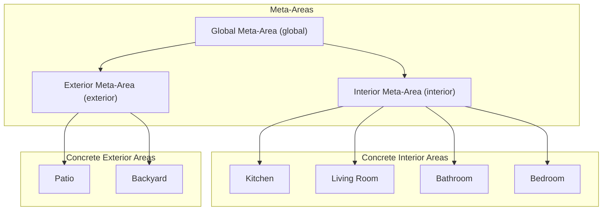
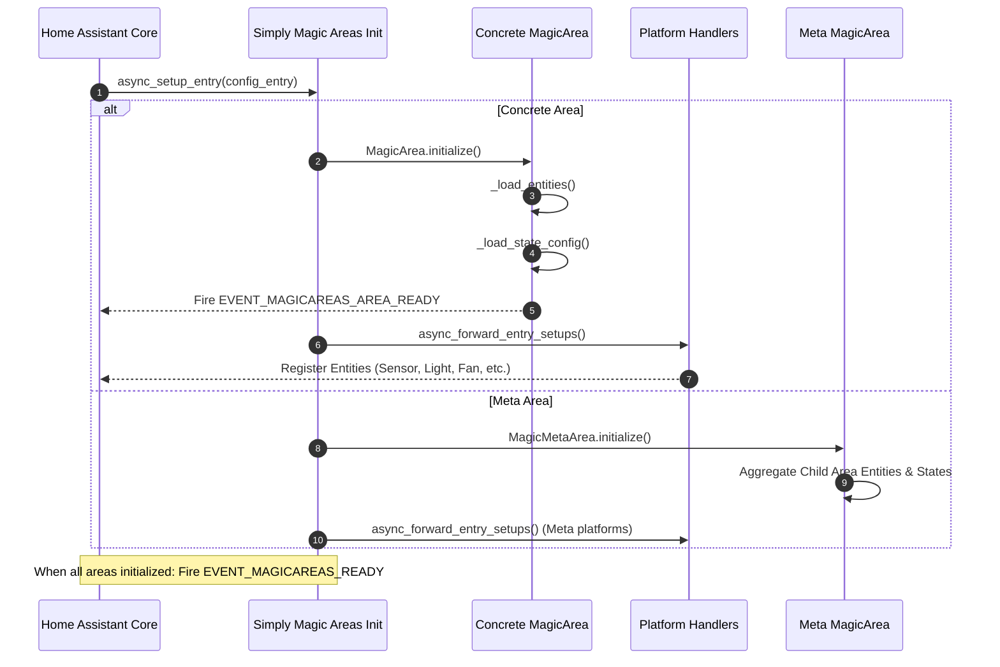
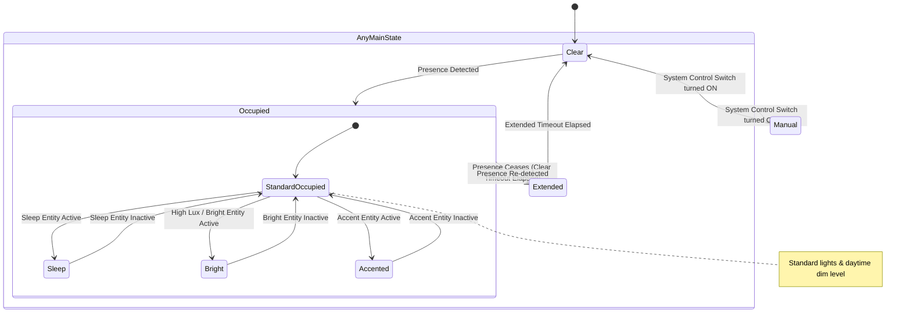

# Simply Magic Areas — Technical System Specification

## 1. Executive Summary

**Simply Magic Areas** is a Home Assistant custom integration that transforms static physical areas into dynamic, reactive, stateful environments. By grouping devices, synthesizing occupancy presence from disparate sensors, tracking ambient environmental trends, and coordinating automations across platforms (lighting, climate, ventilation, covers, media players, and distress monitoring), it turns areas into autonomous smart rooms.

---

## 2. System Architecture & Topology

### 2.1 Area Hierarchy & Meta-Areas

Simply Magic Areas categorizes spaces into two primary constructs:

1. **Concrete Areas**: Directly mapped to Home Assistant Area Registry entries.
   - **Interior (`interior`)**: Standard indoor rooms (living room, bedrooms, bathrooms).
   - **Exterior (`exterior`)**: Outdoor spaces (patio, backyard, driveway).
2. **Meta-Areas**: Synthetic aggregations created at higher spatial levels.
   - **Global (`Global`)**: Aggregates all interior and exterior areas across the entire home. Hosts global capabilities such as the Area-Aware Media Player (AAMP).
   - **Interior Meta-Area (`Interior`)**: Aggregates all interior spaces.
   - **Exterior Meta-Area (`Exterior`)**: Aggregates all exterior spaces.

### 2.2 Lifecycle & Initialization Workflow

---

## 3. Core State Machine Engine (`AreaStateSensor`)

The area state is exposed as an enum sensor (`sensor.simply_magic_areas_state_<area_slug>`) backed by `SensorDeviceClass.ENUM`. The state machine operates on a two-tier hierarchy: **Main States** (governing area presence and automation lifecycle) and **Substates** (governing lighting levels and scenes while the area is occupied).

### 3.1 Main States (Presence & Lifecycle)

The main state defines whether the room is occupied or vacant, and whether automated control is enabled. **The `occupied` state is based entirely on the presence of the presence sensors in the room.**

| State | Identifier | Description |
| :--- | :--- | :--- |
| **Clear** | `clear` | Idle base state. No presence detected by presence sensors and all timeout buffers have expired. Automated lights turn off or dim to clear level. |
| **Occupied** | `occupied` | Primary presence state. **Based entirely on active detection from presence sensors** (motion sensors, occupancy sensors, media playback, or room presence sensors). Acts as the parent container for lighting substates. |
| **Extended** | `extended` | Transitionary timeout grace period after presence sensors cease detecting presence before reverting to `clear`. Keeps area ready or dimly lit for quick re-entry. |
| **Manual** | `manual` | Override state entered when the area system control switch is turned OFF (`switch.simply_magic_areas_system_control_<area>`). Suspends all automated state transitions and device controls across the area. *(Note: Individual light manual override also transitions lights into a manual state for a configurable timeout; see Section 4.1).* |

### 3.2 Occupied Substates (Lighting Context Modifiers)

Substates (`sleep`, `bright`, `accented`) are contextual modifiers that take effect **only when the area is in the `occupied` main state**. They dictate what light fixtures turn on and what dimming levels to apply:

| Substate | Identifier | Context & Lighting Behavior |
| :--- | :--- | :--- |
| **Standard Occupied** | `occupied` | Default active profile when no secondary context overrides apply. Activates standard task and ambient lighting at configured daytime/occupied brightness. |
| **Sleep** | `sleep` | Bedtime/nighttime mode is active (e.g., bed presence or night mode helper). Configures low-level pathway lighting or night-lights at minimal brightness. |
| **Bright** | `bright` | High ambient lux / daylight threshold is active. Keeps lights off or dialed down to avoid redundant daytime illumination. |
| **Accented** | `accented` | Accent entity is active (e.g. party mode, dinner scene, decorative lighting). Prioritizes accent and architectural lighting fixtures. |

### 3.3 Substate Evaluation & Interaction with Main States

Substates (`sleep`, `bright`, `accented`) control **what happens when the state is occupied in terms of what levels to set the lights at and which fixtures to activate**.

> [!IMPORTANT]
> **Substate Transition Rule for Lights:**
> - When the contextual state changes (e.g. from `bright` to `sleep` at sunset or bedtime), the state of the lights **must stay as `occupied`, `clear`, `extended`, or `manual` and not change**.
> - If the lights are currently ON (`occupied`), transitioning between substates (`sleep`, `bright`, `accented`) causes the lights to **immediately update to the new target values and fixtures**.
> - If the lights are currently OFF (`clear`, `extended`, `manual`), transitioning between substates does **not** turn lights on; they remain off until presence is detected.

#### State & Lighting Transition Matrix

| Current Main State | Current Light State | Context / Substate Change | Resulting Main State | Resulting Light State | Action Taken |
| :--- | :--- | :--- | :--- | :--- | :--- |
| **`clear`** | OFF | `bright` ➔ `sleep` (or any substate change) | `clear` (Unchanged) | OFF (Unchanged) | None. Lights remain off. No unprompted illumination. |
| **`extended`** | OFF / Dim | `bright` ➔ `sleep` (or any substate change) | `extended` (Unchanged) | Unchanged | None. Extended countdown continues unaffected. |
| **`manual`** | Any | `bright` ➔ `sleep` (or any substate change) | `manual` (Unchanged) | Unchanged | None. Automation remains completely suspended. |
| **`occupied`** | ON | `bright` ➔ `sleep` | `occupied` (Unchanged) | ON (Unchanged) | **Immediately updates** brightness to sleep level & activates sleep fixtures. |
| **`occupied`** | ON | `sleep` ➔ `bright` | `occupied` (Unchanged) | ON (or OFF if 0% lux cutoff) | **Immediately updates** brightness to daylight level (or off if 0%). |
| **`occupied`** | ON | `occupied` ➔ `accented` | `occupied` (Unchanged) | ON (Unchanged) | **Immediately updates** to accent scene/dim levels and accent fixtures. |
| **`clear`** ➔ **`occupied`** | OFF | Motion / Presence detected in `sleep` mode | `occupied` | ON | Turns ON lights configured specifically for `sleep` mode. |

### 3.4 State Transition Diagram

### 3.5 Presence Detection Sources

> [!NOTE]
> **Occupancy Derivation Principle:** The `occupied` main state is based **entirely on the presence of the presence sensors in the room**. Contextual entities (such as sleep switches, bright/lux entities, or accent toggles) do not influence presence detection; they only modulate lighting behavior once occupancy has been established by presence sensors.

The presence state is continuously tracked from the following configured platforms and device classes:
- **Binary Sensors**: Primary occupancy indicators matching configured device classes (`motion`, `occupancy`, `presence`).
- **Media Players**: Filtered by active playing states (`playing`) when media player presence tracking is enabled.
- **MQTT Room Sensors**: Distance/RSSI room tracking entities matching the area slug (`CONF_MQTT_ROOM_PRESENCE`).
- **Humidity Trend Monitor**: Optional derivative rate-of-change statistics (`MagicStatisticsSensor`) to detect shower/bath occupancy before absolute humidity thresholds trigger.

---

## 4. Platform Controllers & Capabilities

### 4.1 Lighting (`light.py`)
- **Entity**: `AreaLightGroup` (`light.simply_magic_areas_light_<area>`).
- **State-Driven Lighting Profiles**:
  - Each Main State (`clear`, `extended`) and Occupied Substate (`occupied`, `sleep`, `bright`, `accented`) has dedicated configuration:
    - Target dim level percentage (0–100%).
    - Explicit list of active lighting entities assigned to that substate.
- **Substate Transition Rules**:
  - **State Invariance**: When the contextual substate changes (such as from `bright` to `sleep`), the state of the lights stays as `occupied`, `clear`, `extended`, or `manual` and does not change.
  - **Lights ON (`occupied`)**: If the lights are on (`occupied`) and the contextual substate changes between `sleep`, `bright`, and `accented`, the lights **immediately update to the new values** (brightness level, color temperature, and active entity subset).
  - **Lights OFF (`clear`, `manual`, or `bright` at 0%)**: If the lights are off, substate changes (e.g. `bright` to `sleep` at night) do **not** trigger any light command. The lights remain off and the state remains `clear` or `manual` without change.
  - **New Presence Detected**: When the area transitions from `clear` or `extended` into `occupied`, the lights turn ON using the active substate's configured settings.
- **Manual Light State & Override (`CONF_MANUAL_TIMEOUT`)**:
  - **Transition to Manual State**: If someone manually adjusts a light (turns a light on or off, adjusts brightness, or changes color via a physical wall switch, smart dimmer, external integration, or Home Assistant UI), the light entity automatically transitions into a **Manual State** (exposing `manual_control: true` in its extra state attributes).
  - **Override Automatic State**: While in this manual state, the automatic lighting control is completely overridden and suspended. Automatic area state changes, substate context shifts (e.g. transitioning from `bright` to `sleep`), or clearance timeout transitions will **not** modify, turn off, or turn on the lights. This guarantees that automated routines do not "fight" human manual preferences.
  - **Configurable Override Duration**: The manual state persists for a user-configurable duration (`manual_timeout`, default: `60s`). Each subsequent manual adjustment resets the timeout back to the full configured duration.
  - **Automatic Restoration**: When the configured `manual_timeout` period elapses without further manual interactions, the manual state automatically clears (`manual_control: false`). The light returns to automatic control and smoothly realigns with the current area state and active substate profile.

### 4.2 Ventilation & Fans (`fan.py`)
- **Entity**: `AreaFanGroup` (`fan.simply_magic_areas_fan_<area>`).
- **Post-Occupancy Ventilation (`extended` state)**:
  - **Bathroom & Room Exhaust**: When occupants leave the room and the area transitions from `occupied` to `extended` (e.g. leaving a bathroom), the lighting turns off (or dims to clear level) and the exhaust fan **automatically turns ON**.
  - **Extended Duration**: The fan remains on for the duration of the configured `extended_timeout` period before turning off when transitioning to `clear`, unless prolonged by elevated humidity.
- **Humidity Trend-Based Ventilation (`MagicStatisticsSensor`)**:
  - **Rising Humidity Activation**: Continuously monitors the derivative rate-of-change (gradient) of ambient humidity. When a rapid humidity rise is detected exceeding `CONF_HUMIDITY_TREND_UP_CUT_OFF` (default: `100.0` %/hr, indicative of a shower or bath starting), the fan **automatically turns ON**.
  - **Dual Shut-off Criteria**: The humidity-driven fan run turns off once either:
    1. **Humidity Drops**: The rate-of-change drops below `CONF_HUMIDITY_TREND_DOWN_CUT_OFF` (default: `-10.0` %/hr), confirming humidity is falling back down towards baseline.
    2. **Gradient Flattens**: The rate-of-change stops changing (`0.0` gradient) and persists for longer than `CONF_HUMIDITY_ZERO_WAIT_TIME` (default: `20 minutes`), ensuring fans do not run indefinitely after humidity stabilizes.
  - **State Precedence**: If humidity triggers the fan on, it will remain running even if the area state leaves `extended` or enters `clear`, until humidity conditions normalize. Similarly, while the room is actively in `extended` state, the fan will not be turned off prematurely by humidity normalization.
- **Manual Fan Override (`CONF_MANUAL_TIMEOUT`)**:
  - Manual adjustments (wall switches, UI) transition the fan group into manual override mode (`manual_control: true`), suspending automated adjustments for `manual_timeout` seconds (default: `60s`).

### 4.3 Climate (`climate.py`)
- **Entity**: `AreaClimateGroup` (`climate.simply_magic_areas_climate_<area>`).
- **Consolidated Thermostat Control**:
  - Unifies multiple HVAC devices in an area.
  - Averages ambient temperature readings (`mean` reduction).
  - Synchronizes target temperatures, HVAC modes (`heat`, `cool`, `auto`, `off`), fan modes, swing modes, and presets across child units.
- **Occupancy Setbacks**:
  - Automatically adjusts climate to comfort setpoints upon occupancy.
  - Applies eco/setback temperatures during `clear` or `sleep` states.

### 4.4 Media Players & Global Notification (`media_player.py`)
- **Area Group**: `AreaMediaPlayerGroup` (`media_player.simply_magic_areas_media_player_<area>`).
  - Aggregates speakers/smart TVs per area; syncs playback state and volume.
- **Area-Aware Media Player (AAMP)**: `AreaAwareMediaPlayer` (Global Meta-Area).
  - **Dynamic Routing**: Dispatches `play_media` calls and TTS announcements dynamically to whichever room currently has active occupancy.
  - If no area is actively occupied, falls back to pre-configured fallback audio sinks or the entire house group.

### 4.5 Binary Sensors & Health Distress Monitor (`binary_sensor.py`)
- **Aggregate Device Classes**:
  - Groups binary sensors having `CONF_AGGREGATES_MIN_ENTITIES` (e.g. `door`, `window`, `motion`).
  - Aggregates using `any` (default) or `all` mode depending on `AGGREGATE_MODE_ALL`.
- **Distress / Area Health Sensor**:
  - Creates `binary_sensor.simply_magic_areas_problem_<area>`.
  - Monitors `smoke`, `gas`, `moisture`, `safety`, and `problem` classes.
  - Fires immediate alerts if any life-safety or environmental hazard sensor is tripped.

### 4.6 Environmental & Statistical Sensors (`sensor.py`)
- **Group Aggregators**:
  - Calculates `mean` (temperature, illuminance) or `sum` (energy, power) for numeric sensors in the area.
- **Statistical Derivatives**:
  - Generates moving statistical analysis (percentiles, rolling averages) via Home Assistant's `StatisticsSensor`.
  - Powers humidity rate-of-rise trend tracking.

### 4.7 Automation Switch (`switch.py`)
- **Entity**: `AreaSystemControlSwitch` (`switch.simply_magic_areas_system_control_<area>`).
- **Function**:
  - Master kill switch for all automated behaviors within the given area.
  - When switched `off`, sets area state to `manual`. When switched `on`, immediately resumes automatic state evaluation.

---

## 5. Entity ID & Unique ID Specifications

| Domain | Entity Translation Key | Entity ID Format | Unique ID Format |
| :--- | :--- | :--- | :--- |
| `sensor` | `state` | `sensor.simply_magic_areas_state_<area_slug>` | `simply_magic_areas_state_<area_slug>` |
| `switch` | `system_control` | `switch.simply_magic_areas_system_control_<area_slug>` | `simply_magic_areas_system_control_<area_slug>` |
| `light` | `light` | `light.simply_magic_areas_light_<area_slug>` | `simply_magic_areas_light_<area_slug>` |
| `fan` | `fan` | `fan.simply_magic_areas_fan_<area_slug>` | `simply_magic_areas_fan_<area_slug>` |
| `climate` | `climate` | `climate.simply_magic_areas_climate_<area_slug>` | `simply_magic_areas_climate_<area_slug>` |
| `media_player`| `media_player` | `media_player.simply_magic_areas_media_player_<area_slug>` | `simply_magic_areas_media_player_<area_slug>` |
| `media_player`| `area_aware_media_player` | `media_player.simply_magic_areas_area_aware_media_player_<slug>`| `simply_magic_areas_area_aware_media_player_<slug>` |
| `cover` | `cover_<class>` | `cover.simply_magic_areas_cover_<class>_<area_slug>` | `simply_magic_areas_cover_<class>_<area_slug>` |
| `binary_sensor`| `<device_class>` | `binary_sensor.simply_magic_areas_<class>_<area_slug>` | `simply_magic_areas_<class>_<area_slug>` |
| `binary_sensor`| `problem` | `binary_sensor.simply_magic_areas_problem_<area_slug>` | `simply_magic_areas_problem_<area_slug>` |

---

## 6. Configuration & Feature Schema

### 6.1 Core Config Flow Options
- `type`: Area classification (`interior`, `exterior`, `meta`).
- `clear_timeout`: Seconds of sensor inactivity before transitioning `occupied` -> `extended` (default: `60s`).
- `extended_timeout`: Seconds of sensor inactivity before transitioning `extended` -> `clear` (default: `120s`).
- `manual_timeout`: Seconds to remain in manual override mode when a light is manually adjusted before returning to automatic control (default: `60s`).
- `update_interval`: Periodic heartbeat re-evaluation interval (default: `60s`).

### 6.2 Feature Flags (`CONF_ENABLED_FEATURES`)
- `advanced_light_groups`: Enables scene-driven brightness and entity controls for lights.
- `fan_control`: Enables automatic occupancy and humidity-based fan operation.
- `climate_control`: Enables climate group entity and presence-based temperature setpoint coordination.
- `media_player_groups`: Enables area speaker synchronization.
- `area_aware_media_player`: Enables global dynamic media routing (Global Meta-Area only).
- `cover_groups`: Enables cover grouping by device class.
- `aggregation`: Enables numeric/binary sensor grouping.
- `health`: Enables distress/problem aggregation for environmental safety.
- `humidity`: Enables humidity rate-of-change statistics sensor.
