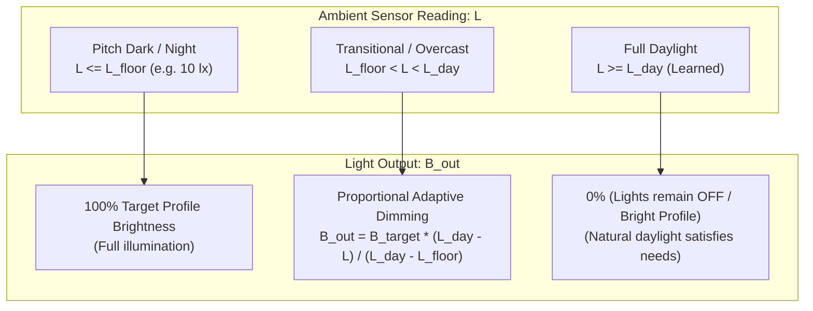
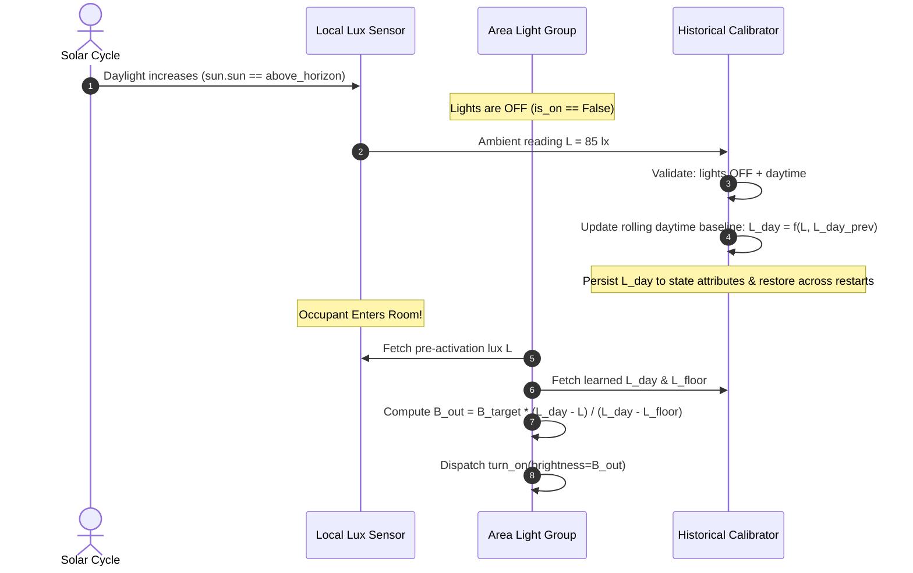

# Adaptive In-Situ Lux Lighting & Self-Calibrating Daylight Architecture

## 1. Executive Summary & Problem Analysis

In automated smart environments, lighting control must dynamically adjust to ambient conditions. However, real-world deployment across diverse residential spaces reveals severe limitations with conventional, static lux thresholds:

1. **Hardware & Calibration Variance**: Commercial consumer lux sensors (e.g., Aqara PIR/illuminance, Philips Hue Outdoor/Indoor, Shelly BLU, ESPHome BH1750, Aeotec MultiSensor 7) exhibit discrepancies of up to $300\%\text{–}500\%$ when measuring identical luminous flux. Some report raw ADC counts, others report filtered lux, and some only update upon motion events.
2. **In-Situ Spatial Geometric Variance**: In the same home under the same sky:
   - A sensor positioned 1 meter from a south-facing bay window may register $800\text{–}1500\text{ lx}$ at midday.
   - A sensor mounted in a recessed hallway corner or bookshelf in a north-facing bedroom may top out at $25\text{–}45\text{ lx}$ in broad daylight.
   - A sensor inside an interior powder room, closet, or windowless bathroom reads $0\text{–}3\text{ lx}$ regardless of outdoor weather or time of day.
3. **The Static Threshold Failure Modes**:
   - *Failure Mode A (The Under-Threshold Lock)*: A global threshold of $\text{min\_brightness} = 100\text{ lx}$ means the north-facing bedroom ($25\text{ lx}$ peak) is forever treated as pitch black. Lights turn on at $100\%$ full power at noon on a sunny day.
   - *Failure Mode B (The Over-Threshold Cutoff)*: A high-range sensor hits $100\text{ lx}$ at 06:30 AM at dawn, extinguishing lights when the room still feels noticeably dim and gloomy to occupants.
   - *Failure Mode C (The Windowless Plunge)*: If an interior room inherits brightness from a global entity (e.g. `sun.sun == above_horizon` or an outdoor/parent meta-area lux reading), the windowless bathroom is falsely declared `bright`, leaving entering occupants in pitch darkness with no light activation.

This design document establishes the mathematical foundation, historical learning algorithm, and control architecture for:
- **Autonomous In-Situ Daylight Calibration**: Automatically learning what "daylight" means for *each individual room's sensor* by observing historical daytime lux when artificial lights are off.
- **Proportional Darkness Compensation**: Controlling the exact amount of light output upon entry based on ambient darkness ($L_{floor} < L < L_{day}$).
- **Absolute Dark Lux Floor & Windowless Guarantee**: Enforcing an absolute floor threshold ($L_{floor}$, default $10\text{ lx}$) below which lights **always** turn on at full profile brightness, permanently exempting windowless spaces from false daytime suppression.

---

## 2. Mathematical Formulation & Photometric Models

### 2.1 The In-Situ Ambient Lux Variables

Let:
- $L \in [0, \infty)$ be the instantaneous pre-activation ambient illuminance in lux reported by the room's local sensor.
- $L_{floor} \in [1, 50]$ be the **Dark Lux Floor** (default: $10\text{ lx}$). Readings at or below $L_{floor}$ represent uncompromised physical darkness.
- $L_{day} \in (L_{floor}, \infty)$ be the **Learned Daylight Baseline** for the room's specific sensor.
- $B_{target} \in [0, 255]$ be the target brightness defined by the active lighting profile (`standard`, `sleep`, or `accented`).

### 2.2 Proportional Darkness Compensation Function

When an occupant enters an area, the required artificial light output must smoothly compensate for whatever natural daylight is missing:

$$\text{darkness\_ratio}(L) = \begin{cases} 
1.0 & \text{if } L \le L_{floor} \\
0.0 & \text{if } L \ge L_{day} \\
\dfrac{L_{day} - L}{L_{day} - L_{floor}} & \text{if } L_{floor} < L < L_{day}
\end{cases}$$

The resulting commanded brightness $B_{out}$ is:

$$B_{out} = \text{round}\left( B_{target} \times \text{darkness\_ratio}(L) \right)$$

To prevent fixture buzz, PWM coil whine, or LED flickering at near-zero duty cycles, a practical minimum activation threshold is enforced:
$$\text{if } 0 < B_{out} < B_{min\_hardware} \implies B_{out} = 0 \text{ (lights stay off)}$$
where $B_{min\_hardware} \approx 5\text{–}10$ (approx. $2\text{–}4\%$ duty cycle).

### 2.3 Windowless Space Derivation

A space is mathematically categorized as **Windowless / Interior** if its learned daylight baseline cannot reliably exceed the dark floor:

$$\text{is\_windowless} \iff L_{day} \le L_{floor} + \epsilon \quad (\text{with } \epsilon = 2\text{ lx})$$

For all windowless spaces:
1. $\text{darkness\_ratio}(L) = 1.0$ unconditionally.
2. The active lighting profile is strictly prohibited from resolving to `bright`.
3. Occupancy transitions into `occupied` or `extended` guarantee instantaneous lighting activation ($B_{out} = B_{target}$).

---

## 3. Historical In-Situ Daylight Learning Algorithm

### 3.1 Uncontaminated Sampling Criteria

To prevent feedback loops where ceiling fixtures artificially inflate the daytime baseline, a sample $L_{sample}$ is valid for daylight learning if and only if all three of the following invariants hold:

1. **Artificial Fixtures OFF**: The area light group is completely off:
   $$\text{area.light\_group.is\_on} == \text{False}$$
2. **Solar Daylight Active**: The sun is above the horizon or local daylight is active:
   $$\text{sun.sun} == \text{"above\_horizon"} \lor \text{solar\_elevation} > 0^\circ$$
3. **Sensor Operational**: The local illuminance sensor reports a valid numeric state ($L_{sample} \ge 0$).

### 3.2 Asymmetric Exponential Moving Filter with Peak Retention

Daylight fluctuates due to cloud cover, seasonal sun angles, and tree foliage. The learning model employs an asymmetric filter:
- **Upward Momentum (Fast Adaptation to Peak Daylight)**: When bright natural daylight is observed ($L_{sample} > L_{day}$), the baseline adapts upward quickly to capture the room's true daytime potential:
  $$L_{day}^{(t)} = \beta \cdot L_{sample} + (1 - \beta) \cdot L_{day}^{(t-1)} \quad \text{with } \beta = 0.25$$
- **Midday Tracking & Seasonal Downward Decay**: During peak solar hours (between 11:00 and 14:00 solar time), if the room consistently registers lower peak levels over multiple days (e.g., transition from summer to winter solstice), the baseline slowly decays downward toward new seasonal maximums:
  $$L_{day}^{(t)} = \max\left( L_{floor} + 5.0, \; \gamma \cdot L_{sample} + (1 - \gamma) \cdot L_{day}^{(t-1)} \right) \quad \text{with } \gamma = 0.02$$
- **Cold-Start Bootstrapping**:
  - If no historical baseline has yet been gathered (first boot):
    - If initial daytime ambient $L_{initial} > L_{floor}$, initialize $L_{day} = \max(L_{initial}, 50.0)$.
    - If initial daytime ambient $L_{initial} \le L_{floor}$ (interior room), initialize $L_{day} = L_{floor}$.
  - State attributes persist $L_{day}$ across Home Assistant restarts using `async_get_last_state()`.

---

## 4. Control Invariants & Edge Cases

| Scenario | Local Lux ($L$) | Baseline ($L_{day}$) | Resulting Lighting Behavior | Rationale |
| :--- | :--- | :--- | :--- | :--- |
| **Windowless Bathroom / Closet** | $1\text{–}3\text{ lx}$ | $\le 10\text{ lx}$ | **100% Brightness** | Lux $\le L_{floor}$. Room is recognized as windowless. Bright profile blocked. |
| **Pitch Black Bedroom at Night** | $0\text{ lx}$ | $75\text{ lx}$ | **100% Brightness** (or Sleep Level) | Lux $\le L_{floor}$. Zero daylight available; full artificial illumination needed. |
| **Overcast / Gloomy Morning** | $25\text{ lx}$ | $100\text{ lx}$ | **$\approx 83\%$ Brightness** | Natural light provides minor illumination; lights turn on dimmed to achieve balance. |
| **Sunny Afternoon with Blinds Half-Open** | $80\text{ lx}$ | $100\text{ lx}$ | **$\approx 22\%$ Brightness** | Substantial natural light present; lights turn on at low accent level. |
| **Bright Living Room at Midday** | $350\text{ lx}$ | $300\text{ lx}$ | **0% (Lights remain OFF)** | Lux $\ge L_{day}$. Profile evaluates to `bright`; artificial lighting unnecessary. |
| **Transient Cloud Cover During Occupancy** | Decreases | Static | **No abrupt flashing** | Turn-on brightness is established at entry; in-flight light changes follow hysteresis. |

---

## 5. Architectural Implementation Plan

1. **Configuration (`const.py`)**:
   - `CONF_DARK_LUX_FLOOR` (default: `10` lx): Floor threshold for absolute darkness and windowless room detection.
   - `CONF_LEARN_DAYLIGHT_LUX` (default: `True`): Autonomous learning of room-specific daylight baseline.
   - `CONF_DAYLIGHT_LUX_LEVEL` (default: `0` / auto): Optional user override for fixed daylight baseline.
2. **Lighting Profile Sensor (`AreaLightingProfileSensor`)**:
   - Incorporate dark floor check: If effective lux $\le L_{floor}$, `bright` condition is strictly `False`.
   - Track and expose `historical_daylight_lux`, `dark_lux_floor`, and `is_windowless`.
3. **Light Controller (`AreaLightGroup`)**:
   - In `_turn_on_light()`: Calculate `darkness_ratio` between $L_{floor}$ and effective $L_{day}$.
   - Modulate target brightness smoothly according to missing daylight.
   - Expose `darkness_ratio`, `last_on_illuminance`, and `effective_daylight_lux` attributes on `light.simply_magic_areas_light_<area>`.
4. **Specification & Test Updates**:
   - Synchronize [SYSTEM_SPEC.md](file:///Volumes/ExternalDocs/Documents/GitHub/hass-magic_areas/SYSTEM_SPEC.md) and [tasks.md](file:///Volumes/ExternalDocs/Documents/GitHub/hass-magic_areas/tasks.md).
   - Write comprehensive unit and integration tests covering:
     - Windowless room guaranteed turn-on.
     - Daytime historical lux baseline tracking.
     - Darkness ratio scaling and smooth dimming.
     - Dark floor override of sun/bright profile.
