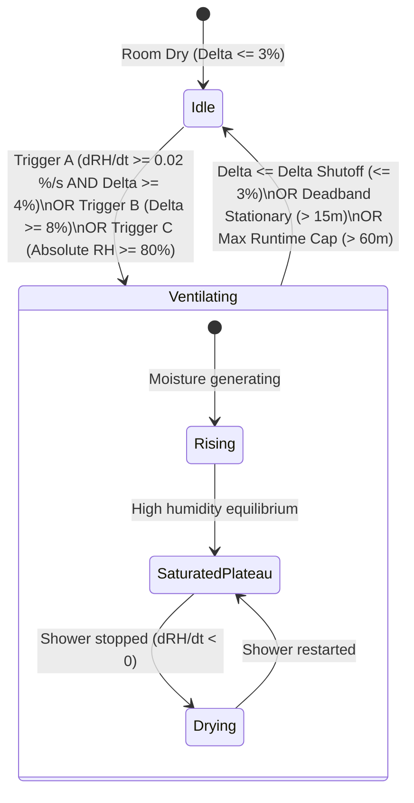

# Engineering Design Document: Bathroom Humidity Dynamics & Adaptive Shower Fan Control

## 1. Executive Summary

Bathroom moisture extraction is one of the most critical automated functions in a residential smart environment. Inadequate ventilation leads to mold growth, drywall deterioration, and peeling paint, while premature shut-off leaves moisture trapped in the room. Conversely, excessive runtime wastes conditioned air and causes unnecessary acoustic disturbance.

This design document establishes the thermodynamic and empirical foundations of bathroom humidity behavior during showering events, analyzes how much humidity changes over time ($dRH/dt$ and $\Delta RH$), evaluates the failure modes of the legacy trend detection model, and details the robust, zero-configuration dual-trigger control architecture implemented in **Simply Magic Areas**.

---

## 2. Physics & Empirical Dynamics of a Shower Event

A standard residential shower introduces a massive, sudden influx of warm water vapor into a relatively small enclosed volume ($15\text{ m}^3$ to $30\text{ m}^3$).

### 2.1 Environmental Parameters & Variables

| Parameter | Typical Value Range | Notes |
| :--- | :--- | :--- |
| **Bathroom Volume ($V$)** | $15\text{ m}^3 - 35\text{ m}^3$ | Small powder/en-suite to large master bathroom. |
| **Water Temperature ($T_w$)** | $38^\circ\text{C} - 43^\circ\text{C}$ ($100^\circ\text{F} - 110^\circ\text{F}$) | High vapor pressure creates rapid evaporation. |
| **Pre-Shower Baseline Humidity ($RH_{base}$)**| $40\% - 60\%$ RH | Indoor ambient, governed by HVAC/weather. |
| **Ventilation Exhaust Rate ($Q$)** | $50\text{ CFM} - 110\text{ CFM}$ ($24 - 52\text{ L/s}$) | Standard residential exhaust fan. |
| **Sensor Reporting Cadence** | $10\text{s} - 60\text{s}$ (or on $\Delta RH \ge 0.5\%$) | Typical Zigbee/Z-Wave/BLE battery sensor. |

---

### 2.2 Chronological Phases of a Shower Event

```mermaid
journey
    title Humidity Lifecycle During a Shower Event
    section Phase 1: Baseline
      Room idle (45-55% RH): 5: Idle
      Zero rate of change (dRH/dt ~ 0): 5: Idle
    section Phase 2: Shower Start
      Water turned on: 3: Rapid Rise
      Vapor spikes (dRH/dt: +0.02 to +0.15 %/s): 1: Fan Turn ON
    section Phase 3: In Progress
      Saturated plateau (75-95% RH): 2: Fan Runs
      Equilibrium (dRH/dt ~ 0.00 %/s, Delta: +25-45%): 2: Fan Runs
    section Phase 4: Shower Stop
      Water off, drying begins: 4: Fan Must Stay ON
      Negative rate (dRH/dt: -0.01 to -0.04 %/s): 4: Fan Must Stay ON
    section Phase 5: Normalization
      Delta drops to <= Delta Shutoff (+3-5%): 5: Fan Turn OFF
      Room fully dry: 5: Fan Turn OFF
```

#### Phase 1: Pre-Shower Baseline ($t < 0$)
- **Humidity**: Ambient indoor level ($RH_{base} \approx 45\% - 55\%$).
- **Differential ($\Delta RH = RH_{area} - RH_{ref}$)**: $\approx 0\% \pm 2\%$.
- **Rate of Change ($dRH/dt$)**: Fluctuation near zero ($\pm 0.0005\%/\text{s}$).
- **Fan State**: OFF.

#### Phase 2: Shower Start & Rapid Vapor Influx ($0 < t \le 3\text{ min}$)
- **Vapor Generation Rate**: A hot shower aerosolizes water into fine droplets with massive surface area. Vapor generation rate is approx. $25 - 40\text{ g/min}$.
- **Humidity Trajectory**: Relative humidity increases from $\approx 50\%$ to $75\% - 90\%+$ within $120 - 300\text{ seconds}$.
- **Numerical Rate of Change ($dRH/dt$)**:
  $$\frac{dRH}{dt} = \frac{\Delta RH}{\Delta t} \approx \frac{+25\%}{180\text{ s}} \approx +0.14\%/\text{s} \quad (+8.3\%/\text{min})$$
  - In a small en-suite: peak rise rate can exceed $+0.25\%/\text{s}$ ($+15\%/\text{min}$).
  - In a large master bath or with the sensor mounted on the opposite wall: rise rate is approx. $+0.02\%/\text{s}$ to $+0.05\%/\text{s}$ ($+1.2\%/\text{min}$ to $+3.0\%/\text{min}$).
- **Target Fan Behavior**: Turn ON **as early as possible** to establish negative pressure, clear mirror fog, and evacuate moisture before it condenses onto cold walls.

#### Phase 3: Shower In Progress / Equilibrium Plateau ($3\text{ min} < t \le t_{off}$)
- **Humidity**: Elevated at $80\% - 95\%$ RH.
- **Differential**: High ($\Delta RH = +25\% \text{ to } +45\%$).
- **Numerical Rate of Change ($dRH/dt$)**: As the air nears saturation and vapor generation balances condensation and extraction, **the slope flattens**:
  $$|dRH/dt| \le 0.005\%/\text{s}$$
- **Target Fan Behavior**: Must **remain continuously ON**.

#### Phase 4: Shower Stops / Evacuation & Active Drying ($t_{off} < t \le t_{dry}$)
- **Water Source Extinguished**: Steam generation ceases immediately.
- **Air Exchange**: Dry conditioned air from the hallway/adjacent room enters under the door undercut while the fan exhausts moist air.
- **Numerical Rate of Change ($dRH/dt$)**:
  $$\frac{dRH}{dt} \text{ becomes NEGATIVE: } -0.01\%/\text{s} \text{ to } -0.04\%/\text{s} \quad (-0.6\%/\text{min} \text{ to } -2.4\%/\text{min})$$
- **Target Fan Behavior**: **CRITICAL INVARIANT:** The fan **MUST REMAIN ON** during this negative slope! Shutting the fan off as soon as the slope becomes negative traps moisture in the room at $80\%$ RH.

#### Phase 5: Full Normalization ($t > t_{dry}$)
- **Return to Baseline**: Differential returns to safe limits ($\Delta RH \le 3\% - 5\%$ above reference).
- **Target Fan Behavior**: Turn OFF.

---

## 3. Analysis of Legacy Vulnerabilities & Failure Modes

A careful audit of legacy/naive humidity control routines identified three severe failure modes in real bathroom environments:

### Failure Mode 1: Premature Shut-off on Negative Trend
- **The Bug**: Checking `if trend_val < trend_down_cutoff: humidity_on = False`.
- **Real-World Impact**: When a resident turns off the shower, $dRH/dt$ immediately becomes negative (e.g. $-0.015\%/\text{s}$ to $-0.03\%/\text{s}$). In the legacy logic, this immediately reset `humidity_on = False` and stopped the fan—leaving the bathroom air saturated at $85\%$ RH and mirrors dripping with condensation!
- **Resolution**: A falling slope is **expected and desirable** while exhausting moisture. The fan must continue running until the differential $\Delta RH \le \text{delta\_shutoff}$ (or stationary plateau deadband).

### Failure Mode 2: The "AND Gate" Activation Deadlock
- **The Bug**: Requiring both `trend_val >= 0.03 %/s` AND `humidity_delta >= 10%` simultaneously.
- **Real-World Impact**:
  - In the first 60 seconds of a shower, `trend_val` is $+0.10\%/\text{s}$ (very high), but $\Delta RH$ has only climbed from $+0\%$ to $+6\%$ ($< 10\%$). Activation is rejected.
  - By the time $\Delta RH$ reaches $+10\%$ at $t=150\text{s}$, the air is approaching saturation and $dRH/dt$ has slowed to $+0.02\%/\text{s}$ ($< 0.03\%/\text{s}$).
  - Result: The activation window was completely missed! The shower is running, the room is steaming, but the fan never engages.
- **Resolution**: Implement **Dual-Trigger Activation** (Trigger A: High rate-of-rise with minimal threshold; OR Trigger B: Sustained differential delta).

### Failure Mode 3: Saturated Soak / Warm Bath Lockout
- **The Bug**: If a bath is drawn slowly or a resident is soaking, $dRH/dt$ never exceeds $+0.03\%/\text{s}$, but ambient humidity climbs to $80\%$ over 15 minutes.
- **Real-World Impact**: Because rate-of-rise never spiked, the fan never turns on even though moisture levels are damagingly high.
- **Resolution**: An absolute/differential threshold trigger ($\Delta RH \ge \text{delta\_threshold}$) ensures the fan engages regardless of rise velocity.

---

## 4. The Recommended Adaptive Shower Fan Control Architecture

### 4.1 State Machine Specification



### 4.2 Mathematical Formulas & Decision Rules

1. **Differential Metric ($\Delta RH$)**:
   $$\Delta RH(t) = RH_{bathroom}(t) - RH_{reference}(t)$$
   *(Where $RH_{reference}$ defaults autonomously to the Interior Meta-Area average or Climate entity).*

2. **Activation Rule ($Fans_{ON} = \text{True}$)**:
   The fan activates if **ANY** of the following conditions are met:
   - **Condition 1 (Fast Dynamic Rise)**:
     $$\frac{dRH}{dt} \ge 0.020\%/\text{s} \quad (1.2\%/\text{min}) \quad \text{AND} \quad \Delta RH \ge 4.0\%$$
     *(Catches showers within the first 30–60 seconds while filtering out HVAC cycling).*
   - **Condition 2 (Elevated Differential)**:
     $$\Delta RH \ge 8.0\%$$
     *(Guarantees activation for gradual humidity increases, warm baths, or distant sensors).*
   - **Condition 3 (Absolute High Limit)**:
     $$RH_{bathroom} \ge 80.0\%$$
     *(Failsafe moisture guard).*

3. **Deactivation Rule ($Fans_{ON} = \text{False}$)**:
   The fan continues running throughout the negative drying slope until **ONE** of the following occurs:
   - **Primary Exit (Dry Baseline Reached)**:
     $$\Delta RH \le \text{delta\_shutoff} \quad (\le 3.0\% \text{ above reference})$$
   - **Secondary Exit (Stationary Plateau Deadband)**:
     $$\left|\frac{dRH}{dt}\right| \le 0.001\%/\text{s} \quad \text{for } t > 900\text{ s } (15\text{ min})$$
     *(Protects against humid summer days where baseline cannot return below 3%).*
   - **Safety Exit (Hard Motor Cutoff)**:
     $$t_{run} > \text{max\_fan\_time} \quad (3600\text{ s } / 60\text{ min})$$

---

## 5. Parameter Tuning Matrix

| Parameter Key | Default Value | Recommended Range | Purpose |
| :--- | :--- | :--- | :--- |
| `CONF_HUMIDITY_TREND_UP_CUT_OFF` | `0.020 %/s` ($1.2\%/\text{min}$) | $0.015 - 0.035$ | Dynamic trigger sensitivity. Lower = faster turn-on. |
| `CONF_HUMIDITY_DELTA_THRESHOLD` | `8.0 %` | $6.0 - 12.0$ | Differential threshold above reference room. |
| `CONF_HUMIDITY_DELTA_SHUTOFF` | `3.0 %` | $2.0 - 5.0$ | Return-to-dry shutoff threshold. |
| `CONF_HUMIDITY_DEADBAND` | `0.001 %/s` | $0.0005 - 0.002$ | Rate considered stationary/flatlined. |
| `CONF_HUMIDITY_ZERO_WAIT_TIME` | `900 s` ($15\text{ min}$) | $600 - 1800$ | Wait time in flatline before deadband shutoff. |
| `CONF_HUMIDITY_MAX_FAN_TIME` | `3600 s` ($60\text{ min}$) | $1800 - 7200$ | Failsafe motor protection. |
| `CONF_HUMIDITY_PRESENCE_GATE_TIME`| `0 s` (Disabled) | $0 - 600$ | Optional gating based on human occupancy. |

---

## 6. Implementation Plan & Architectural Invariants

In accordance with [constitution.md](constitution.md):
1. **Zero Configuration**: Fully automatic reference resolution (defaults to Interior Meta-Area or Climate entity without manual entity configuration).
2. **DRY & Radical Simplicity**: Clear, self-documenting decision branching in `_humidity_fan_control()`.
3. **Spec Synchronization**: Immediate updates to [SYSTEM_SPEC.md](SYSTEM_SPEC.md) and [tasks.md](tasks.md).
