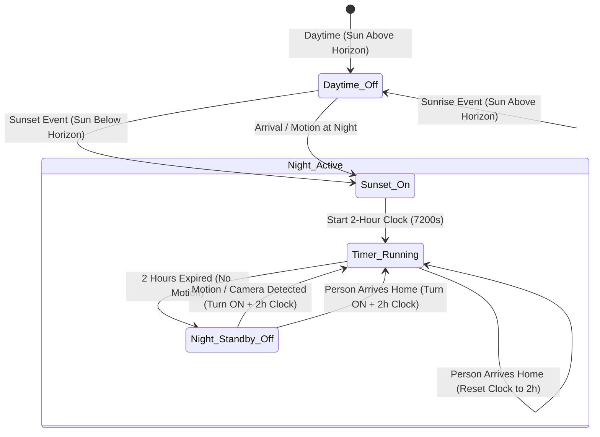

# Exterior Nighttime Lighting & Presence Control Design

## 1. Executive Summary & Objective

This design document establishes the automated lighting architecture for all exterior spaces of the home (both concrete areas classified as `type: exterior` such as Porches, Patios, Driveways, and Yards, as well as the composite `Exterior` Meta-Area). 

The goal is to provide intelligent, autonomous exterior illumination that maximizes safety, security, and energy efficiency with **zero configuration**:
1. **Sunset Illumination**: Exterior lights turn ON automatically at sunset (dusk).
2. **2-Hour Inactivity Window**: Once activated, lights remain ON for at least two hours (7,200 seconds).
3. **Motion & Camera Reactivity**: Movement detected by exterior motion sensors, cameras, or vision/occupancy detectors restarts the 2-hour countdown clock.
4. **Arrival Illumination**: Whenever any resident arrives home (any `person` entity transitioning to `home` at night), exterior lights turn ON (or restart their clock) to safely illuminate entry paths.
5. **Daytime Suppression**: During daytime hours (between sunrise and sunset), exterior lights remain OFF and do not activate on motion or arrival.



---

## 2. Requirements & Behavioral Dynamics

### 2.1 Environmental Boundary Conditions
- **Nighttime Window**: Evaluated via `sun.sun` state (`below_horizon`) and/or solar elevation ($\le 0^\circ$).
- **Daytime Suppression**: When `sun.sun` is `above_horizon` (or solar elevation $> 0^\circ$), exterior lights are suppressed and must remain `off`.
- **Target Scope**:
  - All concrete areas with `area_type == AREA_TYPE_EXTERIOR`.
  - The aggregate `Exterior` Meta-Area (`META_AREA_EXTERIOR`).

### 2.2 Trigger Catalog
1. **Trigger 1 — Sunset (Dusk Event)**:
   - When the sun transitions from `above_horizon` to `below_horizon`, all exterior lights turn ON.
   - The 2-hour inactivity countdown ($T = 7200\text{s}$) is initialized.
2. **Trigger 2 — Exterior Movement (Motion & Camera Sensors)**:
   - Any state change to `on` or motion event from:
     - Companion binary sensors (`device_class` in `motion`, `occupancy`, `presence`) in the exterior area.
     - Camera entities (`camera.*`) assigned to the area.
     - Child exterior areas (if evaluating the `Exterior` Meta-Area).
   - If lights are OFF at night: turn lights ON and initialize 2-hour clock.
   - If lights are already ON at night: restart the 2-hour clock from the moment movement ceases ($t_{\text{off}} + 7200\text{s}$).
3. **Trigger 3 — Resident Arrival**:
   - Monitored across all `person.*` entities in Home Assistant.
   - When any person entity transitions from a non-home state (`not_home`, zone name, or unavailable) to `home` during nighttime:
     - Turns ON exterior lights if currently off.
     - Restarts the 2-hour countdown clock.

### 2.3 Deactivation & Shutoff
- **Timer Expiration**: If 7,200 seconds elapse without any detected motion, camera event, or person arrival, exterior lights turn OFF.
- **Sunrise Clearance**: At sunrise (`sun.sun` transitions to `above_horizon`), any running exterior timer is cancelled and all exterior lights are unconditionally turned OFF.

---

## 3. Mathematical & Timing Model

Let $t$ be current epoch timestamp in seconds, $T_{\text{ext}} = 7200\text{s}$ (default 2 hours), and $S_{\text{night}} \in \{0, 1\}$ represent the nighttime state:

$$S_{\text{night}}(t) = \begin{cases} 1 & \text{if } \text{sun.sun} = \text{"below\_horizon"} \lor \text{elevation} \le 0^\circ \\ 0 & \text{otherwise (Daytime)} \end{cases}$$

Let $E_{\text{motion}}(t) \in \{0, 1\}$ be the boolean presence/motion state of the exterior area, and $A_{\text{person}}(t) \in \{0, 1\}$ be the pulse indicating a person arrival at time $t$.

### 3.1 Expiration Target Derivation
The target shutoff timestamp $t_{\text{expiry}}$ is dynamically updated:
$$t_{\text{expiry}} \leftarrow \begin{cases} 
t + T_{\text{ext}} & \text{upon Sunset Event while } S_{\text{night}} = 1 \\
t + T_{\text{ext}} & \text{upon } A_{\text{person}}(t) = 1 \text{ while } S_{\text{night}} = 1 \\
t + T_{\text{ext}} & \text{upon } E_{\text{motion}} \text{ falling edge } (1 \to 0) \text{ while } S_{\text{night}} = 1 \\
\text{None} & \text{upon Sunrise Event } (S_{\text{night}} \to 0)
\end{cases}$$

### 3.2 Actuation Function
The desired lighting state $L_{\text{ext}}(t)$ is:
$$L_{\text{ext}}(t) = \begin{cases}
1 & \text{if } S_{\text{night}}(t) = 1 \land (E_{\text{motion}}(t) = 1 \lor t < t_{\text{expiry}}) \\
0 & \text{if } S_{\text{night}}(t) = 0 \lor (t \ge t_{\text{expiry}} \land E_{\text{motion}}(t) = 0)
\end{cases}$$

---

## 4. Software Architecture & Implementation

### 4.1 Encapsulation in `AreaLightGroup` (`light.py`)
Rather than forcing synthetic "occupied" presence onto exterior areas (which would falsely mark uninhabited yards as occupied on Home Assistant dashboards), the exterior nighttime routine is managed by `AreaLightGroup`:
- `self._is_exterior`: Identified via `self.area.is_exterior() or (self.area.is_meta() and self.area.id == META_AREA_EXTERIOR.lower())`.
- `self._exterior_timer_cb`: Callback handle for `async_call_later`.
- `self._exterior_timer_ts`: Persisted expiration timestamp.
- `self._exterior_trigger_reason`: Explanatory attribute (`"sunset"`, `"motion"`, `"arrival"`, or `None`).

### 4.2 Decoupling Area Clearance from Exterior Timer
In standard interior areas, transitioning to `clear` immediately calls `self._turn_off_light()`.
For exterior areas:
```python
if self._is_exterior and self._is_exterior_timer_active():
    _LOGGER.debug(
        "%s: Exterior lighting timer active (%ss remaining), keeping lights on despite area clear",
        self.name,
        self._get_remaining_exterior_time(),
    )
    return
```
When `t_expiry` is reached and motion is inactive, the timer callback directly dispatches `self._turn_off_light(force=True)`.

### 4.3 State Tracking & Event Listeners
Exterior light groups register specific listeners in `_setup_listeners()`:
1. `sun.sun`: Listens for `below_horizon` (sunset trigger) and `above_horizon` (sunrise clearance).
2. `person.*`: Dynamically discovers all person entities in `hass.states` and listens for transitions to `STATE_HOME`.
3. Camera & Motion Entities: Subscribes to area presence sensor state changes and camera motion updates.

### 4.4 State Persistence & Restart Resilience
In `async_added_to_hass()`:
- Recovers `ATTR_EXTERIOR_TIMER_TS` from `last_state`.
- If `sun.sun` is `below_horizon` and `target_ts > now`: rehydrates the timer callback for the remaining seconds.
- If expired or daytime: smoothly ensures lights are turned off.

---

## 5. Configuration Options & Defaults

Adhering to our **Radical Simplicity** standard:
- **Zero Config**: All exterior lighting features are enabled by default with a 2-hour timeout.
- **Advanced Customization**: Exposed only in Advanced Settings (`feature_conf_advanced_light_groups`):
  - `CONF_EXTERIOR_LIGHTING_TIMEOUT`: Timeout duration in seconds (default: `7200` = 2 hours).
  - `CONF_EXTERIOR_SUNSET_TRIGGER`: Enable/disable turn-on at sunset (default: `True`).
  - `CONF_EXTERIOR_ARRIVAL_TRIGGER`: Enable/disable turn-on when residents arrive home (default: `True`).

### Extra State Attributes
- `exterior_lighting_active`: Boolean indicating if exterior nighttime automation is holding the lights on.
- `exterior_timer_ts`: Timestamp when the 2-hour stay-on clock expires.
- `exterior_trigger_reason`: Latest activation reason (`"sunset"`, `"motion"`, `"arrival"`).
