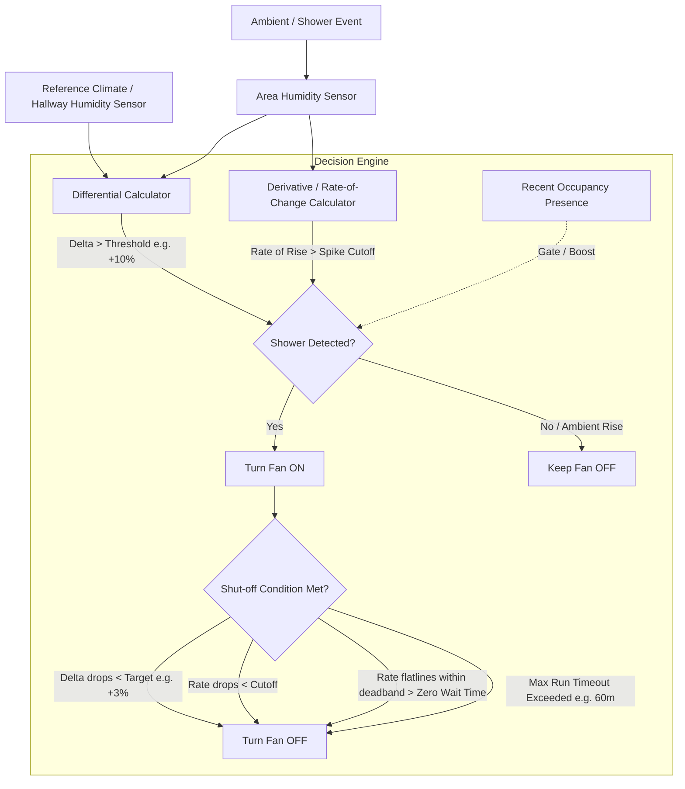

# Enhanced Humidity Fan Control & Climate Comparison — Architecture & Spec Proposal

## 1. Problem Analysis

In real-world deployments, exhaust fans driven by humidity derivative sensors (`change_second` or rate-of-rise) experience the following issues:
1. **General Weather & Climate Shifts**: Diurnal shifts, weather fronts, or whole-house HVAC/humidifier changes can cause room humidity to trend upward quickly enough to cross `CONF_HUMIDITY_TREND_UP_CUT_OFF`, turning exhaust fans on when no shower or bath is running.
2. **Failure to Deactivate (Stuck ON)**:
   - When ambient background humidity remains high, the bathroom humidity never drops below `CONF_HUMIDITY_TREND_DOWN_CUT_OFF` (which requires a negative derivative of `-10%`/hr).
   - In floating-point sensor math, derivative sensors rarely report an exact `0.0`. They fluctuate between values like `+0.002` and `-0.001`. The current check (`if float(humidity_trend.state) != 0.0: reset_zero_timestamp()`) continuously wipes the zero timer, preventing `CONF_HUMIDITY_ZERO_WAIT_TIME` from ever elapsing.
   - Result: The fan gets stuck ON indefinitely.

---

## 2. Proposed Architecture & Solution Design

We propose a multi-layered, robust approach combining **Differential Climate Humidity Tracking**, **Shower Spike Derivative Analysis**, **Deadband Flatline Detection**, and a **Fail-Safe Timeout**.



---

## 3. Key Components of the Proposed Solution

### 3.1 Reference Climate / Baseline Humidity Comparison (Differential Humidity)
- **Reference Entity Configuration**:
  - Add `CONF_REFERENCE_HUMIDITY_SENSOR` (optional entity selector in Config Flow under Humidity options).
  - Can point to an outdoor weather entity, whole-house thermostat/climate humidity sensor, or an adjacent space (e.g. `sensor.hallway_humidity` or `sensor.interior_humidity`).
  - If unset in a child area, SMA can optionally look up the `Interior` Meta-Area's average humidity as an automatic baseline.
- **Differential Thresholds**:
  - `CONF_HUMIDITY_DELTA_THRESHOLD` (default: `10.0%`): The area humidity must rise at least `10%` **above the reference humidity baseline** to trigger shower ventilation.
  - `CONF_HUMIDITY_DELTA_SHUTOFF` (default: `3.0%`): The fan turns off once area humidity returns to within `3%` of the reference humidity baseline, even if absolute humidity in the home remains high.

### 3.2 Enhanced Derivative & Shower Spike Recognition
- Distinguish between gradual weather rises (typically 1–3% over an hour) and shower spikes (typically 10–30% within 2–5 minutes).
- Require both a positive rate-of-rise **and** confirmation via absolute delta or steep gradient threshold.

### 3.3 Deadband Near-Zero Detection (Fix for `!= 0.0` Stuck State)
- Replace the strict check `float(trend) != 0.0` with a configurable deadband:
  ```python
  CONF_HUMIDITY_DEADBAND = 2.0  # %/hr
  is_flat = abs(float(humidity_trend.state)) <= CONF_HUMIDITY_DEADBAND
  ```
- If the rate remains within `[-2.0, +2.0] %/hr` continuously for `CONF_HUMIDITY_ZERO_WAIT_TIME` (default: `15-20 min`), the system recognizes the humidity has stabilized and shuts off the fan.

### 3.4 Presence Gating (Optional)
- Showers only occur when someone is in the bathroom. If the area has been in `clear` for longer than a configurable window (e.g., 30 minutes) and no presence is detected, upward humidity drift is attributed to HVAC/weather and will not engage exhaust fans.

### 3.5 Maximum Run Timeout (Safety Fail-Safe)
- `CONF_HUMIDITY_MAX_FAN_RUN_TIME` (default: `60 minutes`):
  - Hard cap that guarantees an exhaust fan will never run longer than the maximum duration continuously from humidity, protecting fan motors and HVAC energy efficiency.

---

## 4. Configuration Schema Extensions

| Option Key | Name | Type | Default | Description |
| :--- | :--- | :--- | :--- | :--- |
| `reference_humidity_sensor` | Reference Humidity Entity | `entity_id` | `None` (or interior meta) | Climate or hallway sensor used as ambient baseline. |
| `humidity_delta_threshold` | Relative Humidity Delta | `float` (5–30%) | `10.0%` | Minimum humidity above reference required to trigger. |
| `humidity_delta_shutoff` | Relative Humidity Delta Shut-off | `float` (1–10%) | `3.0%` | Shut-off delta above reference baseline. |
| `humidity_deadband` | Flatline Deadband | `float` | `2.0` (%/hr) | Rate-of-change range considered "no change". |
| `humidity_zero_wait_time` | Flatline Duration Before Off | `int` (seconds) | `1200` (20m) | Duration rate must stay within deadband before off. |
| `humidity_max_fan_time` | Maximum Humidity Run Time | `int` (seconds) | `3600` (60m) | Absolute safety timer before fan automatically turns off. |

---

## 5. Specification Updates for `SYSTEM_SPEC.md`

We will update **Section 4.2 (Ventilation & Fans)** and **Section 6.2 (Feature Flags & Schema)** to formalize:
1. Differential climate comparison logic.
2. Deadband-based flatline detection replacing strict `0.0`.
3. Fail-safe timeout safeguards.
