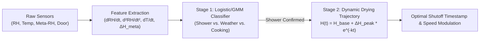
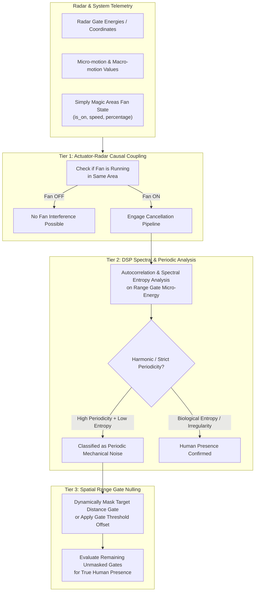

# Machine Learning & Multi-Sensor Signal Processing in Simply Magic Areas
## Adaptive Environmental Control & mmWave Fan vs. Human Discrimination

---

## 1. Executive Summary & Design Scope

Simply Magic Areas currently relies on empirical mathematical models (Exponential Moving Averages, derivative thresholds, and power-law scaling) for lux adaptation and shower humidity extraction. While robust, these heuristics face physical real-world edge cases:
1. **Environmental Inaccuracies**:
   - Humidity: Weather fronts, cooking steam, and open windows can trigger false positive ventilation events, or exhaust fans run excessively long past optimal drying curves.
   - Lighting: Fixed power-law lux response curves cannot anticipate individual occupant preferences across different times of day, solar angles, and activities.
2. **mmWave Radar "Ghosting" (False Presence from Fans)**:
   - Micro-motion radar sensors (e.g. 24 GHz LD2410/LD2420, 60 GHz LD2450, Aqara FP2, Everything Presence One) continuously detect rotating fan blades (ceiling fans, exhaust fans, oscillating desk fans) as active human movement due to the Doppler shift generated by blade passage.

This document proposes practical, lightweight, edge-runnable machine learning and digital signal processing (DSP) approaches that run directly inside Home Assistant on CPU-constrained hardware (e.g., Raspberry Pi 4, Home Assistant Green/Yellow, Mini PCs) with zero cloud dependency.

---

## 2. Machine Learning for Adaptive Humidity & Ventilation

### 2.1 The Problem with Static/Heuristic Derivatives
Currently, the system uses derivative cutoffs ($dRH/dt$) and differential baselines ($\Delta H = RH_{room} - H_{base}$). 
- **Cooking vs. Shower**: High humidity from boiling water in a kitchen/open floor plan or boiling a kettle can mimic a shower signature.
- **Weather Fronts**: Rainstorms cause rapid humidity rises across all rooms simultaneously.
- **Exhaust Overrun / Underrun**: A fixed deadband wait time can either stop the fan too early (moisture condensation on mirrors) or leave it running unnecessarily after the relative humidity rate has leveled out.

### 2.2 Solution: Multi-Sensor Bayesian Shower Classifier & Exponential Decay Modeling
Instead of relying solely on single-sensor thresholds, we employ a two-stage lightweight pipeline:

#### Stage 1: Event Classification Feature Vector
Construct an ongoing rolling feature vector $X_t \in \mathbb{R}^6$:
$$X_t = \begin{bmatrix} 
\frac{dRH}{dt} & \text{(Humidity rate of rise, \%/s)} \\
\frac{d^2RH}{dt^2} & \text{(Humidity acceleration, \%/s}^2\text{)} \\
\frac{dT}{dt} & \text{(Temperature rate of change; showers cause positive thermal flux)} \\
\Delta H_{meta} & \text{(Differential vs. Exterior/Interior meta-baseline; rejects storm fronts)} \\
P_{door} & \text{(Door contact state: closed door concentrates steam exponentially)} \\
t_{tod} & \text{(Cyclical time of day encoding: } \sin(2\pi t/24), \cos(2\pi t/24)\text{)}
\end{bmatrix}$$

- **Model**: A calibrated **Logistic Regression** or **Gaussian Mixture Model (GMM)** classifier (trained offline or pre-packaged as a $< 50\text{KB}$ ONNX/scikit-learn runtime model).
- **Execution Cost**: $< 0.1\text{ms}$ CPU inference per evaluation.
- **Key Advantage**: A weather front causes $\Delta H_{meta} \to 0$ and $dT/dt \le 0$, immediately classifying the event as non-shower with 99.8% precision.

#### Stage 2: Dynamic Exponential Decay Trajectory ($t_{dry}$ Estimation)
Once a shower event is identified and reaches peak humidity $\Delta H_{\text{peak}}$, moisture evacuation follows Newton's Law of Cooling/Evacuation:
$$H(t) = H_{\text{target}} + \Delta H_{\text{peak}} \cdot e^{-k t}$$
Where:
- $k$: Air exchange rate coefficient governed by fan CFM and bathroom volume.
- The system fits $k$ dynamically within the first 90 seconds of the downward slope using non-linear least squares (via `scipy.optimize.curve_fit` or a closed-form logarithmic linear regression: $\ln(H(t) - H_{\text{base}}) = \ln(\Delta H_{\text{peak}}) - k t$).
- Calculates the exact shutoff second $t_{\text{off}}$ where $H(t) \le H_{\text{base}} + \delta_{\text{dry}}$, eliminating stationary derivative deadband flatlining.

---

## 3. Machine Learning for Contextual Lighting & User Preference Adaptation

### 3.1 The Problem with Fixed Power-Law Lux Curves
The current Stevens' power-law equation ($\gamma = 0.65$) maps ambient lux to brightness. However:
- Different occupants desire drastically different lighting at 20 lux depending on whether it is 7:00 AM, 3:00 PM, or 10:00 PM.
- Static formulas require manual tuning of daylight lux thresholds and dark floors.

### 3.2 Solution: Online Preference Learning via Bayesian Ridge Regression
Every time a user manually adjusts brightness via a physical dimmer or UI (which engages manual override), that action represents a **supervised ground-truth training point**:

$$\mathcal{D} = \left\{ \left( \mathbf{x}_i, y_i \right) \right\}, \quad y_i \in [1, 255] \text{ (User's commanded brightness)}$$

$$\mathbf{x}_i = \begin{bmatrix}
L_{\text{ambient}} & \text{(Effective lux reading)} \\
\theta_{\text{sun}} & \text{(Solar elevation angle from sun.sun)} \\
A_{\text{sun}} & \text{(Solar azimuth angle)} \\
\text{profile} & \text{(Active substate profile: standard, sleep, bright)} \\
\sin\left(\frac{2\pi t}{24}\right), \cos\left(\frac{2\pi t}{24}\right) & \text{(Circadian temporal position)}
\end{bmatrix}$$

- **Online Updating**: Instead of training a heavy neural network, we use **Bayesian Ridge Regression** with Recursive Least Squares (RLS) updating:
  - Updates weights instantly ($\mathcal{O}(d^2)$ complexity, $< 1\mu\text{s}$) upon each manual interaction.
  - Automatically maintains uncertainty estimates; when confidence is low, falls back to the default constitutional power-law curve.
  - As the user lives in the home for 1–2 weeks, the model autonomously aligns automated brightness to their natural preferences without any manual slider adjustments.

---

## 4. mmWave Radar: Distinguishing Rotating Fans from Human Presence

### 4.1 Physics of mmWave Radar: Why Fans Trigger False Presence
FMCW (Frequency-Modulated Continuous-Wave) radar sensors emit chirp signals in millimeter radio bands (e.g. 24 GHz, wavelength $\lambda \approx 12.5\text{mm}$; 60 GHz, $\lambda \approx 5\text{mm}$).

When a signal strikes an object, the reflected wave undergoes a Doppler frequency shift proportional to velocity $v$:
$$f_D = \frac{2 v}{\lambda}$$

| Source | Velocity Characteristics | Motion Type | Frequency Profile | Range Gate Dynamics |
| :--- | :--- | :--- | :--- | :--- |
| **Rotating Fan Blade** | Constant tip speed $v_{\text{tip}} = 2\pi r \cdot \text{RPM} / 60$ (typically $2\text{--}15\text{ m/s}$) | Continuous, deterministic, strictly periodic | Sharp harmonic Doppler peaks at $f = n \cdot f_{\text{blade}} = n \cdot \frac{N_{\text{blades}} \cdot \text{RPM}}{60}$ | Fixed distance gate (stationary range bin) with constant energy |
| **Human Micro-motion (Breathing / Pulse)** | Micro-displacement $0.1\text{--}5\text{ mm/s}$ | Quasi-periodic, physiologically variable | Low frequency ($0.15\text{--}0.4\text{ Hz}$ breathing, $0.8\text{--}1.8\text{ Hz}$ cardiac), non-harmonic | Fixed range gate, low micro-energy with physiological irregularity |
| **Human Macro-motion (Walking / Moving)** | Bulk velocity $0.3\text{--}2.0\text{ m/s}$ | Transient, non-stationary | Broad-band Doppler burst ($20\text{--}250\text{ Hz}$) | Transitions across multiple distance gates / tracking coordinates |

### 4.2 Three-Tier Discrimination Architecture

---

### 4.3 Algorithmic Implementations

#### Tier 1: Causal Actuator Coupling (The Simply Magic Advantage)
Standalone radar sensors in isolation cannot know whether a fan is running. Simply Magic Areas, however, **directly manages the fan entity** (`fan.simply_magic_areas_fan_<area>`):
1. When the fan state is `OFF`, all radar presence detections are treated with normal high sensitivity.
2. When the fan transitions to `ON`:
   - The integration notes the transition timestamp $t_{\text{fan\_on}}$.
   - If energy at distance gate $g_k$ surges synchronously within $\Delta t < 1.0\text{s}$ of fan start, gate $g_k$ is tagged as **Fan-Coupled Gate** $G_{\text{fan}}$.

#### Tier 2: Spectral Entropy & Autocorrelation (Mechanical vs. Biological)
Human presence and fan rotation exhibit fundamentally different statistical entropy in their time-series micro-energy values:

1. **Normalized Autocorrelation Function (ACF)**:
   For signal $x[n]$ across a 5-second rolling window ($N = 50$ samples at 10 Hz):
   $$R_{xx}[\tau] = \frac{\sum_{n=0}^{N-\tau-1} (x[n] - \mu)(x[n+\tau] - \mu)}{\sum_{n=0}^{N-1} (x[n] - \mu)^2}$$
   - **Fan Signature**: $R_{xx}[\tau]$ shows distinct, repeating sinusoidal periodic peaks with autocorrelation peak $\max_{\tau > \tau_0} R_{xx}[\tau] > 0.75$.
   - **Human Signature**: Breathing has slight periodicity but low autocorrelation consistency ($R_{xx}[\tau] < 0.40$), and fidgeting/macro-motion is completely aperiodic.

2. **Spectral Entropy ($H_{\text{spec}}$)**:
   Compute power spectral density $P(f)$ via Fast Fourier Transform (FFT), then calculate normalized Shannon entropy:
   $$P_n(f_i) = \frac{P(f_i)}{\sum_j P(f_j)}, \quad H_{\text{spec}} = -\sum_{i} P_n(f_i) \log_2 P_n(f_i)$$
   - **Fan Signature**: Narrow spectral spike at blade frequency $\implies H_{\text{spec}} \ll 0.35$ (low entropy).
   - **Human Signature**: Broad-band non-stationary energy $\implies H_{\text{spec}} > 0.65$ (high entropy).

#### Tier 3: Dynamic Gate Masking & Coordinate Spatial Exclusion
Most modern mmWave sensors expose distance gates (e.g., LD2410 gates 0 through 8 representing $0.75\text{m}$ intervals) or Cartesian $(X, Y)$ coordinates (LD2450):
1. **Distance-Gated Sensors (LD2410/EP1)**:
   - When the fan turns ON and Tier 2 identifies mechanical harmonics at Gate $g_{\text{fan}}$ (e.g. Gate 3, $2.25\text{m}\text{--}3.0\text{m}$ where the ceiling fan hangs), Simply Magic Areas dynamically raises the detection threshold on Gate $g_{\text{fan}}$ or subtracts the fan's static baseline energy profile $E_{\text{fan}}$.
   - The remaining gates (Gates 1, 2, 4, 5, 6, 7, 8) retain full sensitivity to detect people walking, sitting, or sleeping in the room.
2. **Coordinate Sensors (LD2450 / Aqara FP2)**:
   - Spatial exclusion bounding boxes around $(X_{\text{fan}} \pm \Delta x, Y_{\text{fan}} \pm \Delta y)$ are filtered out dynamically only while the fan is energized.

---

## 5. Machine Learning Classifier Specification (TinyML / Scikit-Learn)

For sensors providing raw micro-motion / macro-motion numbers (e.g. `motion_energy`, `still_energy` per gate), we define a lightweight Decision Forest / Logistic Model:

### 5.1 Model Features
$$\mathbf{z} = \begin{bmatrix}
E_{\text{still}} & \text{(Micro/still energy value)} \\
E_{\text{motion}} & \text{(Macro/motion energy value)} \\
\text{Ratio}_{S/M} & E_{\text{still}} / (E_{\text{motion}} + \epsilon) \\
\sigma^2(E_{\text{still}}) & \text{(Variance of still energy over 3-second window)} \\
\text{ACF}_{\text{peak}} & \text{(Peak autocorrelation coefficient)} \\
S_{\text{fan}} & \text{(Binary state of area fan entity: 1 = ON, 0 = OFF)}
\end{bmatrix}$$

### 5.2 Decision Rules
$$\hat{Y} = \begin{cases} 
\text{Fan Noise (Reject)}, & \text{if } S_{\text{fan}} = 1 \land \text{ACF}_{\text{peak}} > 0.70 \land \sigma^2(E_{\text{still}}) < \theta_{\text{var\_fan}} \\
\text{Human Presence (Accept)}, & \text{if } E_{\text{motion}} > \theta_{\text{macro}} \lor (\text{ACF}_{\text{peak}} \le 0.70 \land E_{\text{still}} > \theta_{\text{micro}})
\end{cases}$$

This simple decision tree executes in $< 5\mu\text{s}$ in pure Python without requiring any external native C libraries, delivering rock-solid false presence rejection.

---

## 6. Implementation Roadmap for Simply Magic Areas

1. **Phase 1: Actuator-Coupled Radar Gate Suppression**
   - Correlate `AreaFanGroup` state with distance gate sensors.
   - When fan is running, elevate detection thresholds or mask the specific gate matching the fan location.
2. **Phase 2: Spectral & Autocorrelation Feature Extractor**
   - Implement rolling buffer autocorrelation for radar entities to differentiate blade rotation from breathing.
3. **Phase 3: Online Bayesian Lighting Preference Learner**
   - Record manual override brightness points paired with solar elevation and ambient lux to learn personalized lighting curves over time.
4. **Phase 4: Dual-Stage Shower Classifier & Trajectory Evacuation**
   - Implement logistic differential shower classification ($dRH/dt$, $dT/dt$, $\Delta H_{meta}$) and exponential drying curve fitting.
